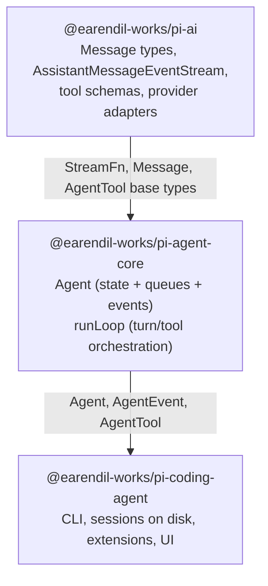
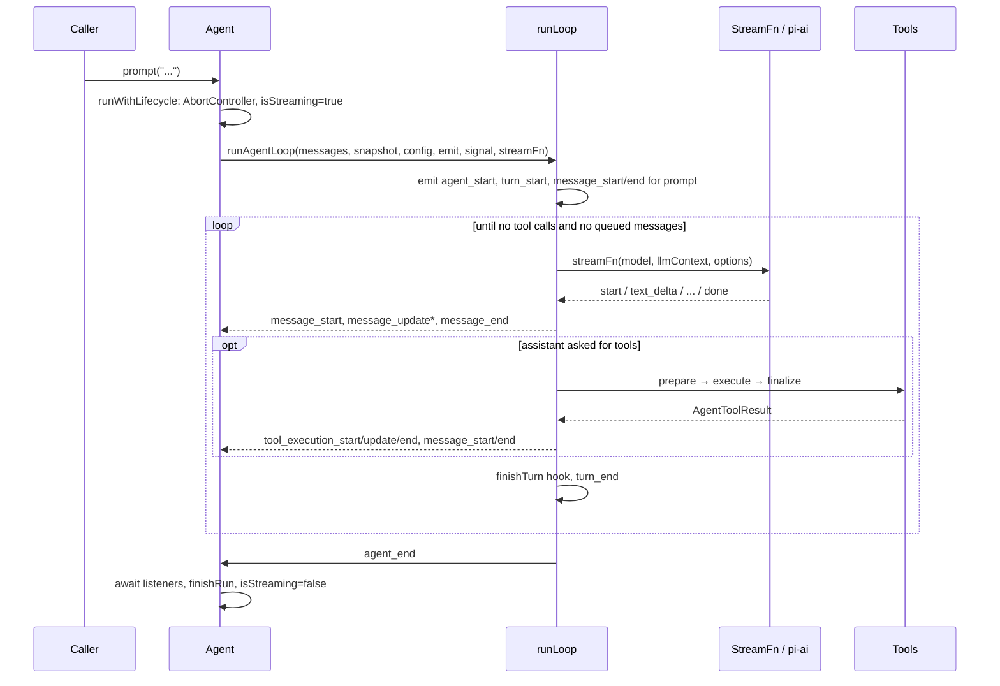
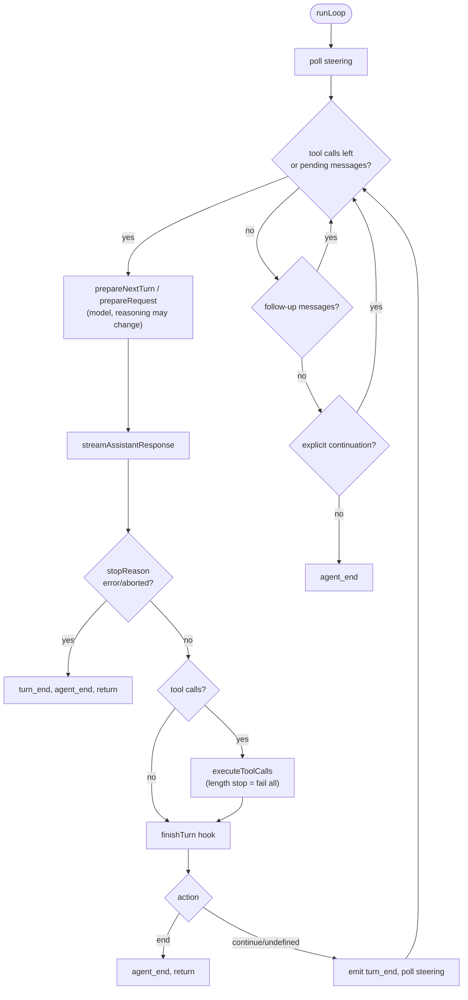
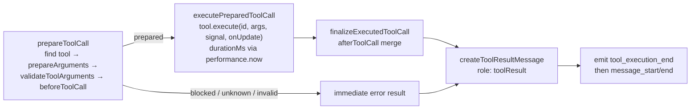
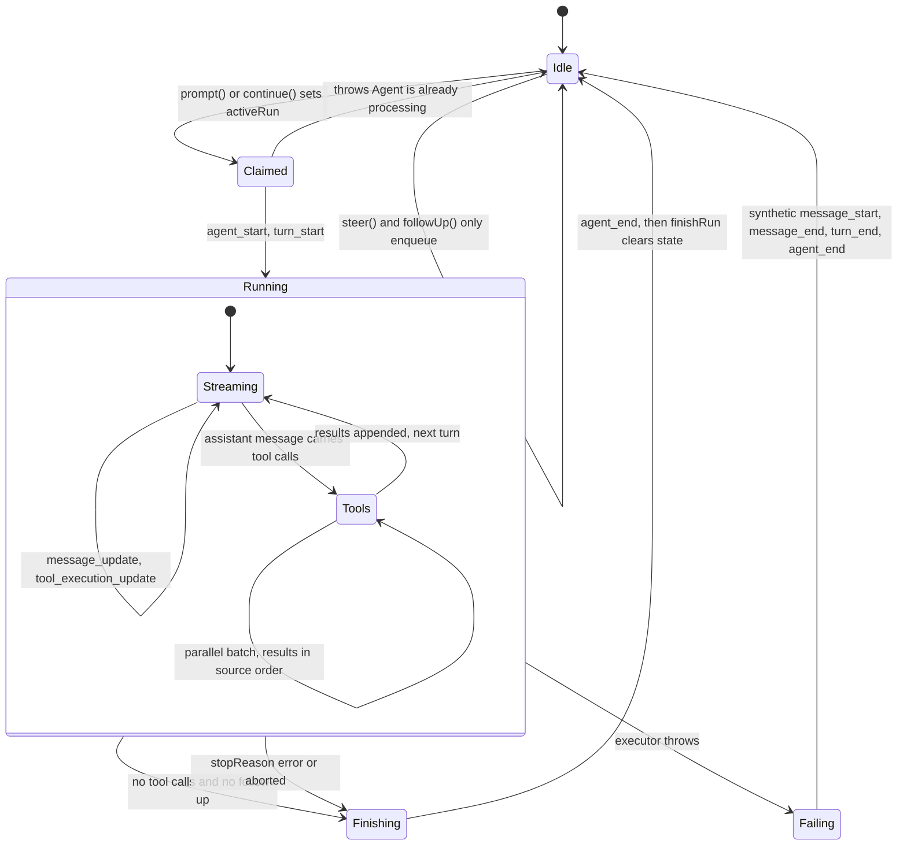
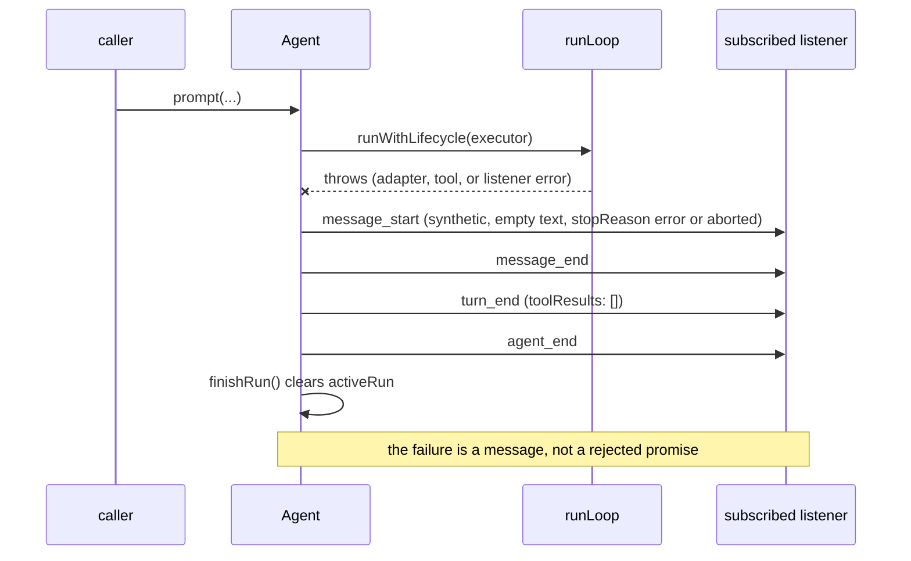

# Pi Agent Core: a Code Map

This is the middle layer of the stack. `@earendil-works/pi-agent-core` is a **stateful agent
loop**: it owns a transcript, streams assistant responses from a model, executes tool calls,
and emits lifecycle events — but it knows nothing about terminals, sessions on disk, or
provider APIs. Its only runtime dependencies are `@earendil-works/pi-ai` (message types,
stream protocol, tool schemas) and `typebox`.

The package's own description is "General-purpose agent with transport abstraction, state
management, and attachment support". This page is the *code* map: where each behavior lives,
which function runs when, and the contracts you must not break. For the narrative tour of
the whole system start with the [coding-agent codebase tutorial](../../coding-agent/docs/codebase-tutorial.md);
for the user-facing API see [`README.md`](../README.md).

| | |
|---|---|
| Source | 6 files, 2,519 lines in `packages/agent/src/` |
| Entry | `src/index.ts` re-exports `agent.ts`, `agent-loop.ts`, `proxy.ts`, `types.ts`, plus `setDefaultStreamFn` |
| Tests | 4 files, 91 tests, offline (faux provider) |
| Build | `tsc -p tsconfig.build.json`; published `exports` map has no `source` condition — tests import the source entry (`src/index.ts`) directly |

## 1. Run it first

From the monorepo root (workspaces install once for all packages):

```bash
npm install --ignore-scripts
cd packages/agent
npx vitest --run
```

Expected output on the current tree:

```
 Test Files  4 passed (4)
      Tests  91 passed (91)
   Duration  ~1.1s
```

The suite is deterministic and offline: `test/e2e.test.ts` registers a **faux provider**
(`registerFauxProvider`, `fauxAssistantMessage`, `fauxText`, `fauxToolCall` from
`@earendil-works/pi-ai/compat`) and drives the real loop against scripted responses, so no
API key is needed. That is also the best way to learn the loop — read `test/e2e.test.ts`
alongside `src/agent-loop.ts`.

## 2. Where the package sits



The dependency arrow is real: `src/types.ts` imports every LLM-facing type from
`@earendil-works/pi-ai` (lines 1–16), and `src/agent-loop.ts` imports the helpers that make
tool declaration and argument validation provider-independent (`EventStream`,
`getCurrentTools`, `getToolStateChanges`, `normalizeContext`, `toToolDeclaration`,
`validateToolArguments`, lines 6–17). Coding-agent subclasses nothing here — it *composes*
`Agent` and supplies a session manager.

## 3. File map

| File | Lines | What it is |
|---|---:|---|
| `src/index.ts` | 5 | Barrel: `agent.ts`, `agent-loop.ts`, `proxy.ts`, `types.ts`, `setDefaultStreamFn`. |
| `src/types.ts` | 539 | Every public contract: `StreamFn`, `AgentMessage`, `AgentState`, `AgentTool`, `AgentEvent`, `AgentLoopConfig` and each hook's result type. |
| `src/agent.ts` | 613 | The `Agent` class (state, queues, run lifecycle, event fan-out) and `AgentOptions`. |
| `src/agent-loop.ts` | 949 | The loop itself: `runLoop`, streaming, tool execution (sequential/parallel), hooks. No classes. |
| `src/stream-fn.ts` | 20 | A process-wide default stream function, for hosts that don't pass `streamFn`. |
| `src/proxy.ts` | 393 | `streamProxy`: a `StreamFn` that talks to a server which owns provider auth. |

Two layers inside one package: **`agent.ts` is the object model** (one run at a time, queues,
listeners) and **`agent-loop.ts` is the algorithm** (a pure-ish async function that emits
events and returns the messages it created). The loop never reads `Agent` state; `Agent`
passes it a snapshot (`createContextSnapshot`, agent.ts:460).

## 4. The message model

`AgentMessage` is the LLM union plus anything your app declares:

```ts
// types.ts:365-374
export interface CustomAgentMessages {
	// Empty by default - apps extend via declaration merging
}
export type AgentMessage = Message | CustomAgentMessages[keyof CustomAgentMessages];
```

Apps extend it with TypeScript declaration merging to carry UI-only artifacts (notifications,
file attachments) through the same transcript. Those messages are filtered at the provider
boundary by `convertToLlm` (types.ts:196–222), whose contract is explicit: **it must not
throw or reject** — return a safe fallback instead, or the loop dies without a normal event
sequence. The default (`defaultConvertToLlm`, agent.ts:38) keeps `system`, `user`,
`assistant`, and `toolResult`.

Two things that surprise newcomers:

1. **The system prompt lives in the transcript.** `state.systemPrompt` is a *getter* that
   replays it from the leading system message (`getCurrentSystemPrompt(messages)`,
   agent.ts:89–91). Setting `initialState.systemPrompt` or `initialState.tools` seeds that
   message via `createInitialSystemMessage` (agent.ts:85–86). To change the prompt later you
   append a system message — you do not reassign a field.
2. **Tools are declared twice, deliberately.** `context.tools` is what the runtime can
   *execute*; the transcript's system messages declare what the model may *call*. Before every
   request, `declareToolChanges` (agent-loop.ts:333–363) diffs the two with
   `getToolStateChanges(getCurrentTools(...), context.tools.map(toToolDeclaration))` and
   writes `toolsAdded` / `toolsRemoved` onto a system message. That keeps replay exact: a
   resumed transcript reproduces the same tool loadout the model saw.

## 5. The `Agent` class

```ts
// agent.ts:114 — the constructor surface (abridged)
export interface AgentOptions {
	initialState?: AgentInitialState;
	convertToLlm?: (messages: AgentMessage[]) => Message[] | Promise<Message[]>;
	transformContext?: (messages: AgentMessage[], signal?: AbortSignal) => Promise<AgentMessage[]>;
	streamFn: StreamFn;
	getApiKey?: (provider: string) => Promise<string | undefined> | string | undefined;
	beforeToolCall?: ...; afterToolCall?: ...;
	finishTurn?: FinishTurn; prepareRequest?: PrepareRequest; prepareNextTurn?: ...;
	steeringMode?: QueueMode; followUpMode?: QueueMode;
	toolExecution?: ToolExecutionMode;
	// plus sessionId, thinkingBudgets, transport, maxRetryDelayMs, onPayload/onResponse
}
```

**Single-run invariant.** `Agent` allows one run at a time. `prompt()` and `continue()` throw
if `activeRun` is set (agent.ts:374–378, 384–387); mid-run input goes through the queues.
`runWithLifecycle` (agent.ts:507–530) installs an `AbortController`, sets
`isStreaming = true`, runs the executor, converts escapes into a synthetic failure message
(`handleRunFailure`, agent.ts:532–548), and always calls `finishRun()` (agent.ts:550), which
resolves `waitForIdle()` and clears runtime state.

**Queues.** Two `PendingMessageQueue`s (agent.ts:143–174) hold *steering* messages (injected
after the current turn's tools finish) and *follow-up* messages (processed only when the agent
would otherwise stop). `QueueMode` (types.ts:55) is `"all"` or `"one-at-a-time"`; the default
for both is `one-at-a-time` (agent.ts:247–248). `peek()` respects the mode, `drain()` consumes
exactly what `peek()` returned — that pairing is what makes the loop's drain points
deterministic.

**Event fan-out.** `subscribe()` (agent.ts:266) adds a listener that receives every
`AgentEvent` *and the run's abort signal*, awaited in subscription order. `processEvents`
(agent.ts:565–612) first reduces the event into `AgentState` (streaming message, appending on
`message_end`, pending tool-call ids, `errorMessage`), then awaits every listener. So a UI can
render from either the event or the state, and they never disagree.

### Lifecycle of one prompt



## 6. The loop (`agent-loop.ts`)

`runLoop` (agent-loop.ts:163–321) is two nested `while` loops:

- **Inner loop** — runs while there are tool calls to continue or steering messages to inject
  (line 183). Each iteration: optional `prepareNextTurn` (186), emit pending messages (211),
  optional `prepareRequest` (219), stream one assistant response (242), execute its tool calls
  (267), `finishTurn` decision (286), `turn_end` (287), then poll steering (295).
- **Outer loop** — when the inner loop would exit, poll `getFollowUpMessages` (302). If
  non-empty they become pending messages and the inner loop resumes (303–308). Otherwise the
  loop breaks and emits `agent_end` (320).

Three exits are hard: an assistant message with `stopReason === "error"` or `"aborted"`
emits `turn_end` + `agent_end` and returns immediately (245–256); `finishTurn` returning
`{ action: "end" }` ends after `turn_end` (289–292); and `explicitContinuation`
(294, 311–314) forces exactly one extra context-only request when `finishTurn` said
`{ action: "continue" }` but nothing else scheduled work.



Repeated every turn, `streamAssistantResponse` (381–469) does the provider-boundary work in a
fixed order: `transformContext` on `AgentMessage[]` (390) → `convertToLlm` to `Message[]`
(395) → `normalizeContext` (397) → resolve a possibly-expiring API key via `getApiKey` (400)
→ call `streamFn(model, llmContext, {...config, apiKey, signal})` (403). Stream events are
folded into `context.messages` so listeners always see a live partial assistant message
(418, 434), and the `"done"`/`"error"` case swaps in the final message from
`response.result()` (445–455), stamping `thinkingLevel` onto it (409).

**Truncation guard.** If the assistant message stopped for `"length"`, the loop refuses to
execute its tool calls and fails them all with an explanatory error
(`failToolCallsFromTruncatedMessage`, 478–503; called at 267–270). Rationale in the comment:
streamed tool-call arguments are finalized with a best-effort JSON salvage parser, so a
truncated message can yield calls that validate but are silently incomplete.

## 7. Tool execution



- **Prepare** (`prepareToolCall`, 708–777). Unknown tool → immediate error result. Otherwise
  `prepareArguments` shim (694–706), then `validateToolArguments(tool, preparedToolCall)`,
  then `beforeToolCall` with the validated args. `{ block: true }` produces an error result
  carrying `reason`; `terminate: true` on a blocked call participates in the batch
  early-termination rule. Any throw in this phase becomes an immediate error result —
  the function never rejects.
- **Execute** (`executePreparedToolCall`, 821–857). Times with `performance.now()`, forwards
  `onUpdate` partial results, and stops accepting updates once the tool promise settles
  (`acceptingUpdates`, 827/837/842). A throw becomes `isError: true` with the message.
- **Finalize** (`finalizeExecutedToolCall`, 859–910). Applies `afterToolCall` field-by-field:
  `content` and `details` and `usage` replace wholesale (no deep merge), `isError` and
  `terminate` replace the flags, and — subtle — **if `content` is replaced but
  `structuredContent` is not returned alongside it, structured content is dropped**, because
  it may no longer match (884–886, documented at types.ts:84–88).

**Sequential vs parallel.** `executeToolCalls` (508–523) picks sequential when
`config.toolExecution === "sequential"` *or* any tool in the batch declares
`executionMode: "sequential"`. The default is parallel (types.ts:315, agent.ts:253):
preflight (prepare) still happens one call at a time, then the allowed calls run via
`Promise.all` (586–660). Note the two different orders — `tool_execution_end` fires in
**completion** order as each call finalizes, while tool-result *messages* are emitted
afterwards in **assistant source** order (646–654), so transcript order matches the model's
request order regardless of which tool finished first.

**Batch termination.** `shouldTerminateToolBatch` (690) returns true only when *every*
finalized result in the batch has `terminate === true` — one tool asking to stop cannot end a
batch that also contains work.

**Nested tool calls.** `runToolCall` (811–819, exported) runs one call through the identical
prepare/execute/finalize pipeline with the same hooks, but emits no events and appends no
messages. Tools that call other tools (sub-agents, batch runners) use it so permission checks
in `beforeToolCall` still apply.

## 8. Events and state

`AgentEvent` (types.ts:516–539) is a discriminated union in a fixed order per run:

```
agent_start
  turn_start
    message_start / message_update* / message_end        (prompt, steering, follow-up, system)
    message_start / message_update* / message_end        (assistant, streamed)
    tool_execution_start / tool_execution_update* / tool_execution_end
    message_start / message_end                          (each tool result)
  turn_end
agent_end
```

`AgentState` (types.ts:382–421) is the read model: `systemPrompt` (read-only, replayed),
`model`, `thinkingLevel`, `tools` and `messages` (accessors that copy assigned arrays),
`isStreaming`, `streamingMessage`, `pendingToolCalls`, `errorMessage`. The important
distinction, documented at agent.ts:558–564: **`agent_end` means no further events, not
idle.** The agent is idle only after awaited `agent_end` listeners settle and `finishRun()`
clears runtime state — `waitForIdle()` resolves at that point.

Failure synthesis is uniform: an escaped error or an abort produces a *real assistant
message* with `stopReason: "error" | "aborted"` and `errorMessage`, emitted as
`message_start` → `message_end` → `turn_end` → `agent_end` (agent.ts:532–548). Consumers
therefore never need a separate error channel.

## 9. Run lifecycle: the state machine behind the events

The event list in §8 reads like a trace; the thing that produces it is a small state machine with
two levels. `activeRun` (agent.ts:218) is the lock: `runWithLifecycle` refuses a second concurrent
run with `"Agent is already processing."` (agent.ts:508–510) rather than queueing.



Two details the diagram makes obvious but the prose hides:

- **`agent_end` is not the idle boundary.** The comment on `processEvents` (agent.ts:558–564) is
  explicit: `agent_end` means no further loop events will be emitted, but the run is idle only
  after every awaited listener for `agent_end` returns and `finishRun()` (agent.ts:550) clears
  `isStreaming`, `streamingMessage`, `pendingToolCalls`, and `activeRun`. A host that starts a new
  prompt from inside its `agent_end` handler hits the `activeRun` guard.
- **Abort does not add a state.** `abort()` (agent.ts:341) aborts the signal; the loop notices at
  its next checkpoint and breaks out at `stopReason` handling (agent-loop.ts:245), so the machine
  leaves `Running` through the same `Finishing` edge as a normal turn.

### Failure paths, and the synthetic message

Every failure that escapes the loop becomes a well-formed assistant message, so a host never needs
a second error channel:



`handleRunFailure` (agent.ts:532–548) builds that message with `EMPTY_USAGE`, `stopReason` chosen
from `signal.aborted`, and the error text in `errorMessage`; `prompt()` itself resolves normally.

| Failure | Where it is caught | What the host sees |
|---|---|---|
| Provider returns `stopReason: "error"` or `"aborted"` | agent-loop.ts:245 breaks the loop | The provider's message, kept in `messages`; no tool calls run |
| `abort()` called mid-stream | Loop checkpoint, then the same break | Partial text kept, `stopReason: "aborted"` |
| `abort()` called mid-tool | agent-loop.ts:613–623, 738–741, 757–760 | `createErrorToolResult("Operation aborted")` per in-flight call |
| A tool implementation throws | `executeToolCall` catch | `createErrorToolResult(error.message)`; the turn continues |
| A listener throws during `agent_end` | `runWithLifecycle` catch | Synthetic message, then `agent_end` again |
| Run truncated by `stopReason: "length"` | agent-loop.ts:267–270 | Every tool call in that message fails, deliberately |

## 10. `stream-fn.ts` and `proxy.ts`

`setDefaultStreamFn` (stream-fn.ts:11) installs a process-wide fallback; `Agent` uses it when
`streamFn` is omitted (agent.ts:236) and so does the loop (agent-loop.ts:124, 149).
If nothing was installed, `getDefaultStreamFn` throws a message telling you to pass `streamFn`
or call `setDefaultStreamFn()` (stream-fn.ts:15–20). This exists so `pi-agent-core` can run
in a host that supplies its own model runtime without depending on a provider catalog.

`streamProxy` (proxy.ts:107) implements `StreamFn` by POSTing the model, context, and a
serializable subset of options (`ProxySerializableStreamOptions`, proxy.ts:51–62) to a server
that owns provider credentials. The server replies with `ProxyAssistantMessageEvent` frames —
the same event protocol *minus* the `partial` field on every event, to cut bandwidth
(proxy.ts:19–47) — and the client rebuilds partials with `parseStreamingJson`. This is the
"transport abstraction" in the package description: local provider call, or remote proxy,
same loop.

## 11. Contracts worth memorizing

| Contract | Where | Consequence if broken |
|---|---|---|
| `convertToLlm` and `transformContext` must not throw or reject | types.ts:203–205, 231–232 | Loop dies without a normal event sequence. |
| `StreamFn` must not throw for request failures; encode them in the stream as a final message with `stopReason` `"error"`/`"aborted"` | types.ts:27–32 | `handleRunFailure` fires and you lose provider detail. |
| One run at a time | agent.ts:374, 384, 508 | `prompt()`/`continue()` throw; use `steer()`/`followUp()`. |
| Tools are declared to the model via transcript system messages, not `context.systemPrompt`/`context.tools` | types.ts:23–25 | Model calls tools the transcript never declared. |
| `afterToolCall` replaces fields wholesale; replacing `content` without `structuredContent` drops it | types.ts:84–90 | Silent loss of structured output. |
| Parallel mode: `tool_execution_end` in completion order, messages in source order | types.ts:43–45 | UI ordering bugs if you assume one order. |
| `agent_end` ≠ idle | agent.ts:558–564 | You tear down while listeners still run. |

## 12. Where to look next

- `test/agent-loop.test.ts`, `test/agent.test.ts`, `test/e2e.test.ts` — the loop's behavior
  pinned at the level this document describes; `test/utils/calculate.ts` is a complete
  `AgentTool` in 30 lines.
- `packages/ai/README.md` — the stream protocol (`AssistantMessageEvent`) and tool schemas
  this package consumes.
- The [coding-agent codebase tutorial](../../coding-agent/docs/codebase-tutorial.md) — how a CLI
  session composes `Agent` with a session manager, extensions, and the TUI.
