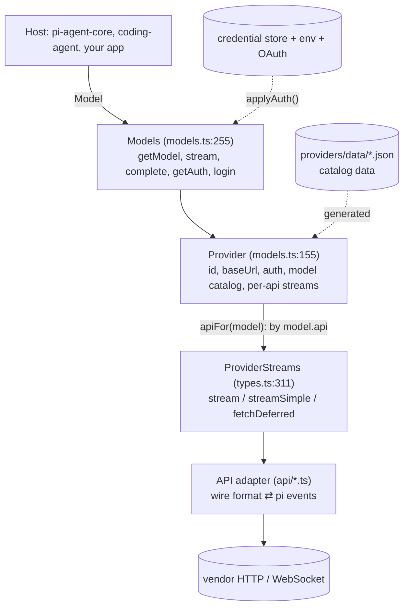
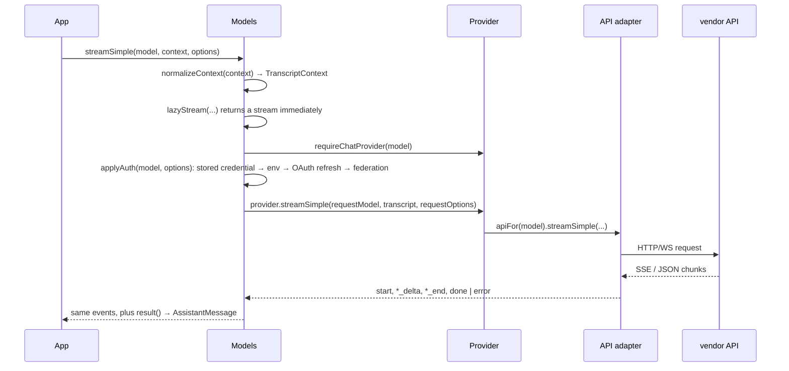
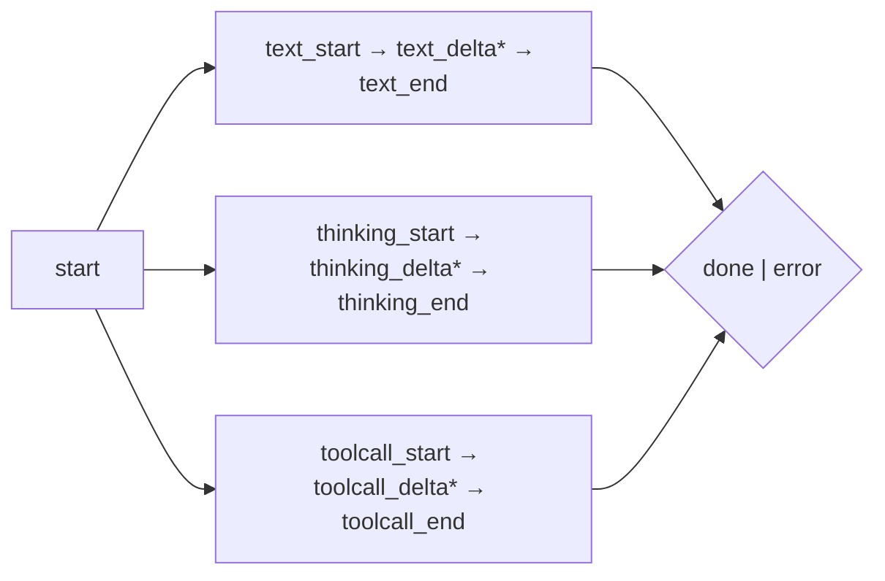
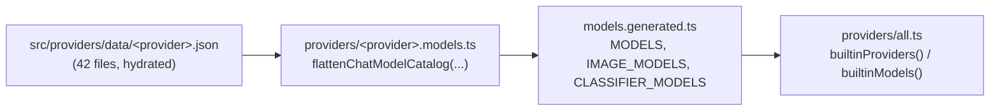

# Pi AI: a Code Map

`@earendil-works/pi-ai` is the layer every other pi package sits on: message types, a
streaming protocol, a provider/model catalog, credential resolution (API keys and OAuth),
tool-schema validation, image generation, and token classifiers. It has no dependency on
agents, terminals, or sessions — it is a *client library for many LLM APIs with one event
protocol*.

That single-protocol promise is the thing to understand first. Every provider adapter —
OpenAI, Anthropic, Bedrock, Google, Mistral, a dozen gateways, llama.cpp — normalizes into
the same `AssistantMessageEventStream`, so `pi-agent-core` and the CLI never branch on
vendor. This page maps how that is achieved and where each piece lives.

| | |
|---|---|
| Source | 199 files, 27,084 lines in `packages/ai/src/` |
| Subdirs | `api/` 43 modules, `providers/` 42 provider modules + 42 catalogs, `auth/` 5 modules + `auth/oauth/` 13 flows, `utils/` 25 modules |
| Known wire APIs | 10 chat (`openai-completions`, `openai-responses`, `azure-openai-responses`, `openai-codex-responses`, `anthropic-messages`, `bedrock-converse-stream`, `google-generative-ai`, `google-vertex`, `mistral-conversations`, `pi-messages`), 1 image, 2 classifier |
| Entry | `src/index.ts` — deliberately side-effect free; providers and APIs are separate subpath entries |

## 1. Run it first

The package's build is data-gated: model catalogs are generated from `src/providers/data/*.json`,
and those JSON files are *hydrated* from the network on demand.

```bash
cd packages/ai
npm run hydrate-model-data      # fetch src/providers/data/*.json (once per checkout)
npm run build:offline           # check:model-data + tsc + copy data into dist/
npx vitest --run test/event-stream.test.ts test/faux-provider.test.ts \
  test/lazy-module-load.test.ts test/models-entry.test.ts test/models-runtime.test.ts \
  test/transcript-tool-changes.test.ts test/validation.test.ts
```

Verified on the current tree: **7 files, 108 tests, all passing, ~1.6 s**, fully offline. Those
seven files cover exactly the machinery described below — the event stream, the faux provider,
lazy loading, the `Models` façade, transcript normalization, and tool-argument validation.

Two verified gotchas:

- `npm run build:offline` fails `check:model-data` on a fresh clone until
  `hydrate-model-data` has run.
- The package's `exports` map has **no `source` condition**, so the README example needs the
  built `dist/`, unlike `packages/durable`, whose examples run straight from source with
  `--conditions=source`.

## 2. Layer map



Four identifiers carry the whole design:

- **`Api`** (types.ts:61–73) — the *wire protocol*, a string union of ten known values plus
  `(string & {})` so third parties can add their own.
- **`Provider`** (models.ts:155) — a vendor: id, base URL, auth definitions, model catalog,
  and a map from `Api` to `ProviderStreams`.
- **`Model<TApi>`** (types.ts:839) — one catalog entry, typed by its api. Options are typed
  per api through `ApiOptionsMap` / `ApiStreamOptions<TApi>` (types.ts:282–310), so
  `models.stream(model, …)` gives you Anthropic-only options when `model.api` is
  `"anthropic-messages"`.
- **`ProviderStreams`** (types.ts:311) — the uniform contract every adapter module satisfies:
  `stream`, `streamSimple`, optional `fetchDeferred` / `cancelDeferred`.

`Model` is one of three shapes under `ModelTypeMap` (types.ts:888): `chat`, `image`
(`ImageModel`), and `classifier` (`ClassifierModel`). `AnyModel` is the union; `hasApi()` and
`isModelType()` are the runtime narrowing helpers.

## 3. File map

| Area | Files | What lives there |
|---|---|---|
| `src/index.ts` | 47 | Core barrel. Its header comment is a design rule: *"Core only, side-effect free: no generated catalogs, no provider factories, no api-registry, no OAuth implementations, no compat."* |
| `src/types.ts` | 898 | Every contract: `Api`, `Provider`, `Model`, `Message`, `AssistantMessage`, `AssistantMessageEvent`, `StreamOptions`, `SimpleStreamOptions`, `Context`/`TranscriptContext`. |
| `src/models.ts` | 1,269 | `createModels` (998), `createProvider` (1047), `Models`/`MutableModels`, auth application, cost and thinking-level helpers. |
| `src/model-catalog.ts` | 81 | Type-level flattening of catalog JSON into typed model maps. |
| `src/models.generated.ts` | 309 | Aggregates all 42 `*.models.ts` catalogs into `MODELS`, `IMAGE_MODELS`, `CLASSIFIER_MODELS`. Generated. |
| `src/models-store.ts` | 46 | Persistence of dynamically refreshed model lists. |
| `src/api/` | 43 | One module per wire API, plus `.lazy.ts` wrappers, shared helpers (`openai-responses-shared.ts` 834, `google-shared.ts` 517, `transform-messages.ts` 256, `constrained-sampling.ts` 298), and `lazy.ts` (99). |
| `src/providers/` | 84 | 42 `<provider>.ts` factories, 42 `<provider>.models.ts` catalogs, `all.ts` (190) registry, `compat-schema.ts` (644), `faux.ts` (727). |
| `src/auth/` | 5 + 13 | `types.ts` (255), `resolve.ts` (217), `credential-store.ts` (67), `context.ts` (45), `helpers.ts` (59); OAuth flows under `auth/oauth/`. |
| `src/utils/` | 25 | `event-stream.ts` (135), `validation.ts` (353), `transcript.ts` (237), `retry.ts` (270), `provider-retry.ts` (128), `json-parse.ts` (149), `overflow.ts` (188), `estimate.ts` (117). |
| `src/compat.ts` | 302 | Legacy global API kept for older hosts. |
| `src/images.ts`, `image-models.ts`, `images-api-registry.ts` | 26 / 50 / 53 | Image-generation façade, model type, api registry. |
| `src/env-api-keys.ts` | 195 | The `*_ENV` constants every provider's auth ladder references. |
| `src/cli.ts` | 124 | Small CLI for listing models / logging in. |

## 4. Request path



The critical property: **`Models.stream*` returns synchronously.** Auth resolution, lazy
import of the adapter, and the request are all awaited *behind* the returned stream
(`lazyStream`, api/lazy.ts:46–72). If setup fails, the stream terminates with an `error`
event carrying a fully-formed `AssistantMessage` — nothing throws at the call site. That is
what lets `pi-agent-core` treat every failure as a normal event sequence.

`normalizeContext` (utils/transcript.ts:30) is what makes `TranscriptContext` (types.ts:785)
a branded type only the library can produce: it folds `systemPrompt` and `tools` into a
leading system message, after which *"the prompt and tool declarations are carried by the
transcript's system messages"*. Adapters therefore never see `systemPrompt` or `tools` as
separate fields.

`applyAuth` (models.ts:849) merges, per field, in this order: `options.apiKey` /
`options.headers` win, then resolved `auth.headers`, then `auth.baseUrl` overrides the model's
base URL, then the optional `transformHeaders` hook runs last. `env` from resolution is merged
with caller env.

## 5. The event protocol



The union is `AssistantMessageEvent` (types.ts:806–826), and the doc comment above it is the
contract:

- Successful streams emit `start` before any update and terminate with `done`; failures
  terminate with `error`. **Updates and `done` must never appear before `start`.**
- `partial` is the *shared live response-so-far* object, not a per-event snapshot: text and
  thinking blocks are empty at `*_start` and grow through `*_delta` until the authoritative
  `*_end`. Redacted thinking may be complete at start and emit no deltas.
- `toolcall_start` arguments are provider-specific; `toolcall_delta` carries JSON updates.
  Parsing is deliberately lenient (`parseStreamingJson`, utils/json-parse.ts) — which is why
  `pi-agent-core` refuses to execute tools from a message truncated by `stopReason: "length"`.

`AssistantMessageEventStream` (utils/event-stream.ts) implements this as a push-based
`EventStream`: a `FifoQueue` for events plus a queue of waiting promise resolvers, so a
consumer that falls behind simply receives buffered events, and `result()` always resolves to
the final `AssistantMessage`. Subclasses stamp `durationMs` from a monotonic clock, but skip
timing when the message's `timestamp` predates the stream — a forwarded/deferred response
started elsewhere stays untimed.

## 6. Providers

A provider factory is small on purpose. OpenAI-compatible vendors are ~15 lines
(`providers/groq.ts`, `cerebras.ts`, `deepseek.ts`, …): pass an id, base URL, auth, catalog,
and the shared `openaiCompletionsApi()`. Vendors with custom auth or quirks are longer —
`anthropic.ts` (90), `google-vertex.ts` (100), `amazon-bedrock.ts` (90), `openrouter.ts` (88).

`anthropic.ts` is the best example of an auth ladder, evaluated in order:

1. stored credential,
2. `ANTHROPIC_AUTH_TOKEN` (header-based token),
3. `ANTHROPIC_OAUTH_TOKEN`, then `ANTHROPIC_API_KEY` (env),
4. workload identity federation (`ANTHROPIC_FEDERATION_RULE_ID`,
   `ANTHROPIC_IDENTITY_TOKEN_FILE`, optional service-account/workspace ids), returned as
   `env` for the SDK to consume.

`createProvider` (models.ts:1047–1188) then assembles the `Provider`:

- `api` may be a single `ProviderStreams` **or** a `Partial<Record<Api, ProviderStreams>>`;
  `apiFor(model)` picks by `model.api` and a missing entry becomes an `error` stream rather
  than a crash.
- `models` is the static catalog; `fetchModels` adds dynamic refresh. Refresh respects
  `context.stored`, `context.allowNetwork`, and `context.signal`, and publishes updates
  through `publish({update})` / `publish({persist, update})` so persistence and in-memory
  state stay atomic.
- `generateImages` and `classify` are attached only when implementations exist, and never
  reject — they return error result objects.

`providers/all.ts` wires everything: `builtinProviders()` returns the 42 factories,
`builtinModels(options)` creates a `MutableModels` and registers them (all.ts:184–190).
`BuiltinProvider` is `keyof typeof MODELS`, so catalog and factories are checked against each
other at compile time.

## 7. Adapters

Every adapter module exports exactly the shape of `ProviderStreams`. The mid-sized
`api/google-generative-ai.ts` (471 lines) shows the pattern:

```
stream        (line 59)   — full-fidelity: takes GoogleOptions, maps every provider concept
streamSimple  (line 305)  — provider-neutral: thinking level, toolChoice, maxTokens
createClient  (line 348)  — auth/SDK client construction
buildParams   (line 369)  — transcript → wire request
getGoogleBudget (line 431) — thinkingLevel → token budget
```

The heavy ones own a lot of realism: `openai-completions.ts` (1,736),
`openai-codex-responses.ts` (1,700) with websocket transport, `anthropic-messages.ts` (1,690),
`bedrock-converse-stream.ts` (1,416), `mistral-conversations.ts` (952). Shared behavior is
factored out, not duplicated: `openai-responses-shared.ts` (834), `google-shared.ts` (517),
`transform-messages.ts` (256), `constrained-sampling.ts` (298) for grammar-constrained JSON,
`simple-options.ts` (108) for `SimpleStreamOptions` mapping.

Retries live in the adapters via `withProviderRetry` (utils/provider-retry.ts), whose policy
explicitly mirrors the pinned OpenAI/Anthropic SDKs: honor `x-should-retry`, retry
408/409/429/5xx and network errors, respect `Retry-After` (capped by `maxRetryDelayMs`,
default 60 s), never retry statuses listed in `noRetryStatuses`. The comment on
`isRetryableProviderError` (line 23) says to re-review when either SDK is upgraded — that is a
real maintenance trap, not decoration.

## 8. Laziness

Adapters are loaded on first use, which is what keeps a 27k-line package cheap to import:

```ts
// api/anthropic-messages.lazy.ts (4 lines)
export const anthropicMessagesApi = (): ProviderStreams => lazyApi(() => import("./anthropic-messages.ts"));
```

`lazyApi` (api/lazy.ts:74) wraps each method so the dynamic import happens inside
`lazyStream`; capability flags (`fetchDeferred`, `cancelDeferred`) are forwarded only when
requested. `models.ts` uses the same `lazyStream` for auth resolution, so the *entire* request
setup path is behind a synchronously-returned stream. `test/lazy-module-load.test.ts` pins
that the module really is not imported until stream time.

## 9. Catalog generation



Catalog JSON is keyed by api, then by `"<type>:<model-id>"` — e.g.
`{"anthropic-messages": {"chat:claude-fable-5": {...}}}` — and `model-catalog.ts` turns that
into typed maps where `ModelId` is the part after the colon (`KeyForType`,
`ModelId`, `ApiForKey`, model-catalog.ts:12–40). `"chat:"` is the default and may be omitted
in `Model.type`, which is why the type comment tells you to narrow with `isModelType()`
rather than comparing `type` strings.

Scripts in `package.json` are the whole lifecycle: `hydrate-model-data` (fetch data only),
`generate-models` (regenerate modules), `check:model-data` (validate), `generate-model-catalog`
(emit JSON artifacts). `providers/data/.manifest.json` is imported by `all.ts` so the build
knows which data it was generated against.

## 10. Auth

`auth/types.ts` (255) defines the shapes: `ApiKeyAuth` and `OAuthAuth` each have `login` and
`resolve`; resolution returns `{ auth: { apiKey?, headers?, baseUrl? }, env?, source }`, where
`source` is a human label for status UI. `auth/resolve.ts` (217) runs the candidate ladder;
`auth/credential-store.ts` (67) persists credentials; `auth/helpers.ts` wraps lazy OAuth
loading.

The OAuth flows under `auth/oauth/` are per vendor and share infrastructure:
`callback-server.ts` (183) for redirect-based login, `pkce.ts` (34),
`device-code.ts` (98), and per-provider flows — `github-copilot.ts` (507),
`openai-codex.ts` (438), `radius.ts` (321), `openai-chatgpt.ts` (309),
`anthropic.ts` (307), `kimi-coding.ts` (296), `xai.ts` (239), `meta.ts` (208),
`openrouter.ts` (169).

`Models.getAuth` (models.ts:749) exposes resolution directly — useful for "is this provider
configured?" UI — and rejects with `ModelsError` codes `"oauth"` (refresh failed, credential
preserved) or `"auth"` (key resolution or store failure).

## 11. Tools, images, classifiers

- **Tool schemas** are TypeBox (`export { Type } from "typebox"` in index.ts) or plain JSON
  Schema. `validateToolArguments` (utils/validation.ts:317) is the single gate used by
  `pi-agent-core`: it rejects flagged parse errors (`argumentsError`), clones the arguments,
  normalizes optional nulls, runs `Value.Convert`, then a compiled validator, coercing
  JSON-Schema tools when the schema is not TypeBox.
- **Images**: `ImageModel` + `ProviderImages.generateImages`, with `openrouter-images.ts` as
  the implementation and `images-api-registry.ts` mapping api → implementation.
- **Classifiers**: `ClassifierModel` + `ProviderClassifier.classify`, used for structured
  state (`typesafe-system-one.ts`, `llama-cpp-classify.ts` for local servers).
- **`providers/faux.ts`** (727) is a full in-memory provider with scripted responses
  (`registerFauxProvider`, `fauxAssistantMessage`, `fauxText`, `fauxToolCall`). It is exported
  from `index.ts` and is how `pi-agent-core`'s tests run the real loop with no network.

## 12. Contracts worth memorizing

| Contract | Where | Consequence if broken |
|---|---|---|
| Core entry must stay side-effect free; catalogs/factories/APIs are subpath entries | index.ts:1–6 | Importing pi-ai pulls in every provider and OAuth flow. |
| A stream must emit `start` before updates and end with `done`/`error` | types.ts:790–805 | Consumers hang or crash on unexpected ordering. |
| `partial` is a shared mutable live object, not a snapshot | types.ts:799–805 | Storing `event.partial` per event gives you N references to one object. |
| `stream()` returns synchronously; setup failures become `error` events | api/lazy.ts:55, types.ts:390 | Callers wrap the call in try/catch and miss the real failure path. |
| Only `normalizeContext` may produce `TranscriptContext` | types.ts:785 | Prompt/tools bypass the system message; adapters see them nowhere. |
| Provider methods for unknown api/implementation return error streams/results, never throw | models.ts:1078–1089 | Missing provider support crashes a UI instead of degrading. |
| One shared retry policy mirrored from vendor SDKs | utils/provider-retry.ts:23 | Double retries or retrying non-idempotent 4xx. |
| Catalog JSON is generated; edit `data/*.json` and regenerate | providers/*.models.ts:1–2, models.generated.ts:1–2 | Hand edits are erased by `npm run generate-models`. |

## 13. Where to look next

- `test/models-runtime.test.ts`, `test/event-stream.test.ts`, `test/validation.test.ts` — the
  four core contracts above, pinned.
- `test/anthropic-sse-parsing.test.ts`, `test/openai-*` — adapter-level normalization.
- `providers/faux.ts` — the smallest complete provider in the tree.
- [`packages/agent/docs/tutorial.md`](../../agent/docs/tutorial.md) — the consumer of this
  protocol: `StreamFn`, tool execution, and the agent loop.
