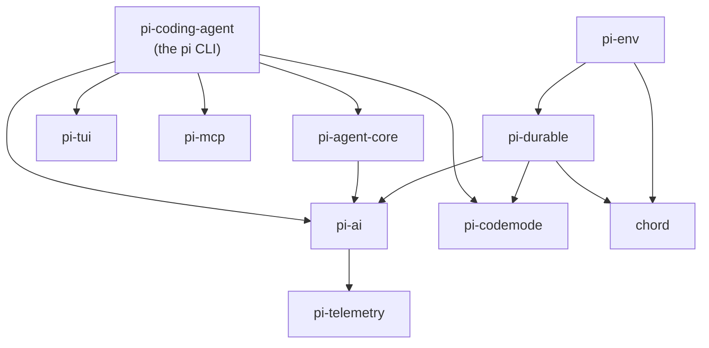
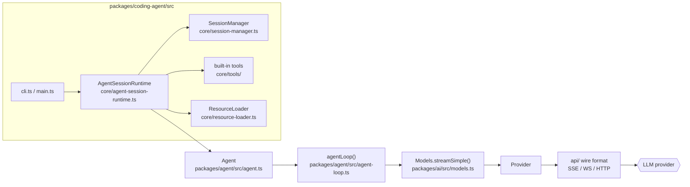
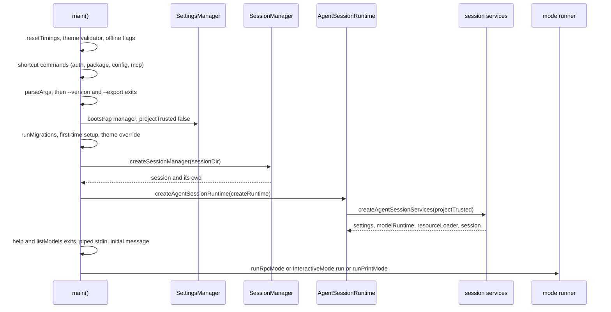
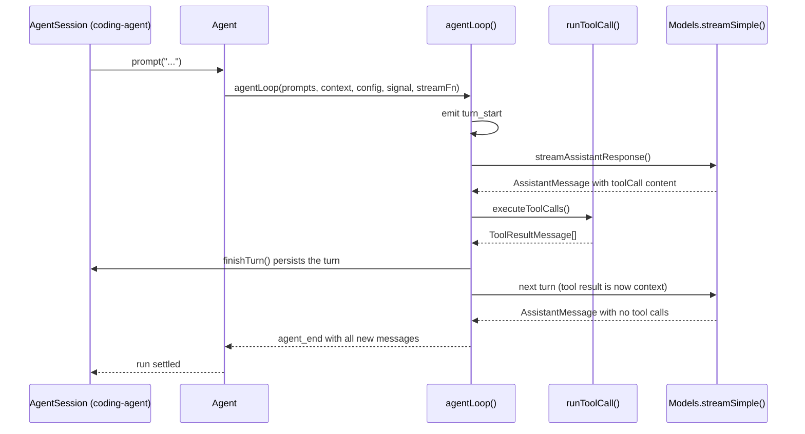
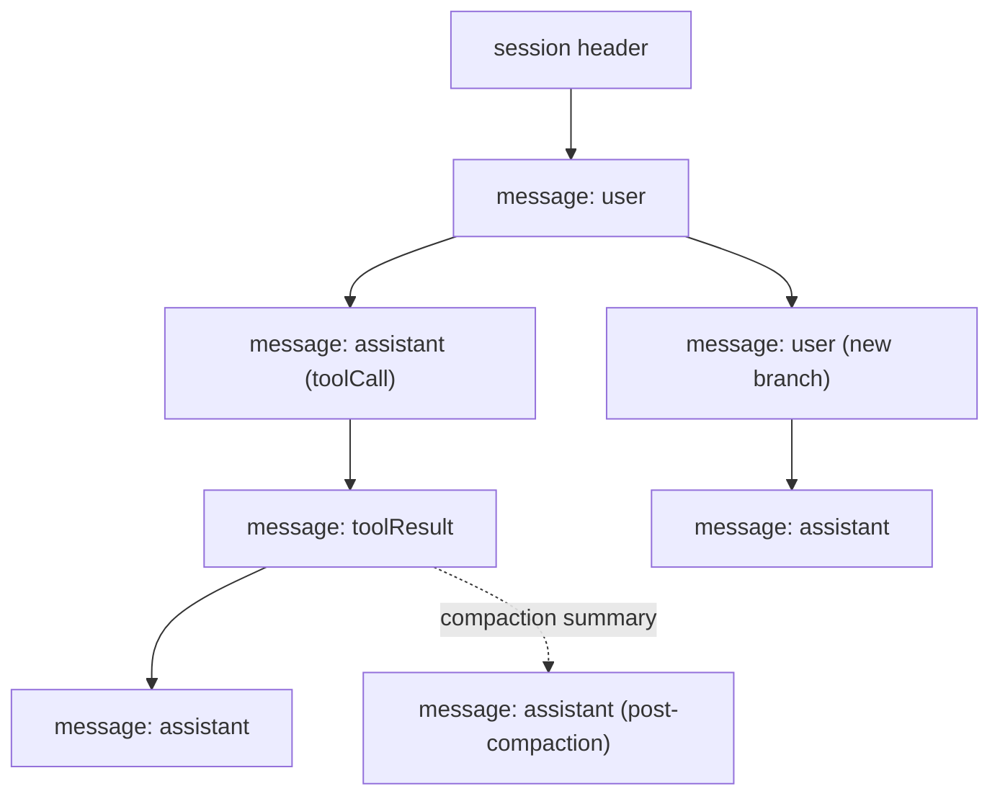

# Pi Codebase Tutorial

This is a map of the Pi source tree: the language and toolchain it is written in, how the
packages fit together, and the runtime path from `pi` on the command line to a streamed
model response and a persisted session.

It is a *code* map, not a user guide. For behavior and configuration see
[How Pi Works](how-pi-works.md), [Extensions](extensions.md),
[Session File Format](session-format.md), and the SDK [sdk.md](sdk.md).

Everything below refers to real files in this repository. Paths are relative to the
repository root unless they start with `packages/coding-agent/`.

## The language and the toolchain

Pi is TypeScript, compiled with TypeScript 7.0.2 and executed by Node.js 22.19 or newer.
The configuration in `tsconfig.base.json` explains most of the style rules:

| Setting | Effect |
| --- | --- |
| `"target": "ES2024"`, `"lib": ["ES2024"]` | Modern runtime features are used directly (`Promise.withResolvers`, `Array.fromAsync`). |
| `"erasableSyntaxOnly": true` | No `enum`, `namespace`, parameter properties, or `import x = require()`. Everything a type checker erases must also be valid JavaScript, so Node can strip types and run the source. |
| `"verbatimModuleSyntax": true` | Type-only imports are written `import type { ... }`. A value import is never silently dropped. |
| `"module": "Node16"`, `"moduleResolution": "Node16"` | ESM semantics with explicit package entry points. |
| `"allowImportingTsExtensions": true`, `"rewriteRelativeImportExtensions": true` | Relative imports carry the `.ts` extension (for example `from "./agent-loop.ts"`). The compiler rewrites them to `.js` on emit. |

The consequence of `erasableSyntaxOnly` plus `.ts` imports is that a source checkout runs
without a build step. `./pi-test.sh` proves it:

```bash
RESOLVER_URL="$(node -p 'require("node:url").pathToFileURL(process.argv[1]).href' \
  packages/coding-agent/src/experimental/source-resolver.ts)"
node --import "$RESOLVER_URL" packages/coding-agent/src/cli.ts
```

The resolver hook (`packages/coding-agent/src/experimental/source-resolver.ts`) maps a
`.ts` specifier to the real file. The installed npm package instead runs the bundled
`dist/bundle/cli.js`, which is why asset paths are resolved through helpers in
`packages/coding-agent/src/config.ts` rather than `__dirname`.

Build and quality commands, from the repository root:

| Command | What it does |
| --- | --- |
| `npm install --ignore-scripts` | Install workspace dependencies. Lifecycle scripts stay off by policy. |
| `npm run check` | Biome with `--write`, then pinned/runtime dependency checks, TS relative-import rules, entry graphs, the coding-agent install lock, `tsc --noEmit`, and a browser smoke test. |
| `./test.sh` | Test suite that skips LLM-dependent tests when no API keys are present. |
| `./pi-test.sh` | Run the CLI from source, no build. |
| `npm run build` | Build every package in dependency order (`chord`, `tui`, `telemetry`, `codemode`, `mcp`, `ai`, `durable`, `env`, `agent`, `coding-agent`). |

Linting and formatting come from Biome (`biome.json`), not Prettier. The repository is an
npm workspace: the root `package.json` lists `packages/*` plus a handful of example
extension directories.

## The packages

`packages/` holds eleven packages. Sizes are non-test TypeScript lines of `src/` at the
time of writing, useful for judging how much reading each one costs.

| Package | npm name | What it is | `src/` |
| --- | --- | --- | --- |
| [`packages/coding-agent`](../../coding-agent/) | `pi-coding-agent` | The `pi` CLI: sessions, tools, extensions, settings, all four interfaces. | 76,024 lines / 254 files |
| [`packages/ai`](../../ai/) | `pi-ai` | Unified multi-provider LLM API: models, auth, streaming, wire formats. | 27,084 / 199 |
| [`packages/durable`](../../durable/) | `pi-durable` | Durable conversation, task, and document runtime. See [tutorial.md](../../durable/docs/tutorial.md). | 25,564 / 83 |
| [`packages/tui`](../../tui/) | `pi-tui` | Terminal UI library with differential rendering. | 19,540 / 46 |
| [`packages/chord`](../../chord/) | `chord` | Typed host runtime: objects, replicated state, RPC over JSON links. | 14,050 / 37 |
| [`packages/mcp`](../../mcp/) | `pi-mcp` | Standalone Model Context Protocol client. | 3,277 / 18 |
| [`packages/codemode`](../../codemode/) | `pi-codemode` | Sandboxed JavaScript execution whose only capability is calling injected tools. | 3,037 / 17 |
| [`packages/agent`](../../agent/) | `pi-agent-core` | The agent loop itself: turns, tools, steering, events. | 2,519 / 6 |
| [`packages/env`](../../env/) | `pi-env` | Remote execution environments for Pi Durable: an SSH-deployed daemon and its client. | 2,346 / 8 |
| [`packages/evals`](../../evals/) | `pi-evals` | Evaluation harness package. | 1,446 / 5 |
| [`packages/telemetry`](../../telemetry/) | `pi-telemetry` | Vendor-neutral telemetry contracts and typed schema helpers. | 935 / 6 |

Two facts follow from that table and shape how you read the code:

- `pi-agent-core` is deliberately small (six files). The loop is not hidden in the CLI.
- `pi-coding-agent` is where the product lives, so most day-to-day work lands in
  `packages/coding-agent/src/core/`.

### Dependency graph

Arrows point from a package to the package it imports. `tui`, `mcp`, `codemode`,
`chord`, and `telemetry` have no internal dependencies, which is what makes them
reusable outside the CLI.



`pi-durable` is not a dependency of the CLI. It is the layer that turns the same agent
loop into something that survives process restarts and runs on serverless platforms;
`packages/coding-agent/src/core/` is the in-memory, single-process equivalent.

## Runtime architecture

Four layers, from the bottom up:

1. **Wire formats** (`packages/ai/src/api/`) — one module per provider protocol:
   `anthropic-messages.ts`, `openai-responses.ts`, `openai-completions.ts`,
   `google-generative-ai.ts`, `mistral-conversations.ts`, `bedrock-converse-stream.ts`,
   and others. Each converts the common message shape into that protocol's request and
   parses its event stream back into the common shape. A matching `*.lazy.ts` file loads
   the implementation on demand so a cold CLI start does not parse every protocol.
2. **Models and providers** (`packages/ai/src/models.ts`, `packages/ai/src/providers/`) —
   `createModels()` (line 998) returns the `Models` interface (line 255); `createProvider()`
   (line 1047) builds a `Provider` (line 155) that owns auth, model discovery, and a
   selected wire format. Provider modules carry their model catalogue in sibling
   `*.models.ts` files, generated into `models.generated.ts` by
   `packages/ai/scripts/generate-models.ts`.
3. **Agent loop** (`packages/agent/src/`) — turns, tool execution, message queues,
   events. No knowledge of terminals, sessions, or files.
4. **CLI and session** (`packages/coding-agent/src/`) — argument parsing, settings,
   resource loading (extensions, skills, prompt templates, themes), the JSONL session
   store, built-in tools, and the four interfaces.



## Startup, step by step

`main()` (main.ts:574) is 425 lines of sequencing, and the order is the design: cheap shortcuts
first, then settings, then the cwd, then services, then a mode. Most "why doesn't `--flag` work
here?" questions are answered by where a step sits in this list.



| Phase | Where | What it decides |
|---|---|---|
| Timings and extension factories | main.ts:574–578 | `time()` markers for `PI_STARTUP_BENCHMARK`; built-ins plus injected factories |
| Offline mode | main.ts:579–583 | Sets `PI_OFFLINE` and `PI_SKIP_VERSION_CHECK` from flag or env |
| Shortcut commands | main.ts:585–621 | `auth`, `package`, `config`, `mcp` each get a chance to own the process and exit |
| Argument parsing | main.ts:623–652 | Diagnostics can exit 1; `--version` and `--export` exit here |
| Bootstrap settings | main.ts:596 | Created with `projectTrusted: false` — project config is not trusted yet |
| Migrations and first-run | main.ts:669–684 | Auth-provider migration, deprecation warnings, theme prompt, theme override |
| Session selection | main.ts:686–718 | Session dir resolves *before* any cwd-bound service, because `--resume` may change the project |
| Trust store | main.ts:720–731 | `ProjectTrustStore`, per-cwd cache, CLI path resolution |
| Runtime factory | main.ts:733–864 | A closure, so a reload can rebuild services with a new `projectTrusted` and a new agent instance |
| Runtime creation | main.ts:866–872 | `createAgentSessionRuntime` runs the factory once and returns `services`, `session`, diagnostics |
| Early exits | main.ts:878–892 | `--help` and `--listModels` print and exit after services exist, so extension flags appear in help |
| Input | main.ts:894–906 | Piped stdin turns interactive into print mode; theme initialised last |
| Diagnostics gate | main.ts:915–925 | Any runtime error exits 1 before a mode starts; an extension-load failure adds a hint |
| Mode dispatch | main.ts:949–998 | RPC, then interactive, then print |

Two invariants that explain a lot of the file's structure:

- **The project-trust decision is deferred, not defaulted.** The bootstrap manager at main.ts:596
  cannot read project settings, because trust is not established; the real manager is built inside
  the factory at main.ts:751 with the resolved value. Anything that needs project config therefore
  lives behind `createRuntime`.
- **The factory is re-run, not re-invented, on reload.** `createRuntime` takes `sessionStartEvent`
  and treats its absence as "initial runtime" (main.ts:740), which is how extension reloads and
  trust changes rebuild services without duplicating startup logic. `projectTrustByCwd` caches the
  answer per directory so a reload does not re-prompt.

## The agent loop

`packages/agent/src/agent-loop.ts` is the whole runtime model. The exported surface is
small:

```ts
export function agentLoop(prompts, context, config, signal, streamFn): EventStream<AgentEvent, AgentMessage[]>
export function agentLoopContinue(context, config, signal, streamFn): EventStream<AgentEvent, AgentMessage[]>
export async function runAgentLoop(prompts, context, config, emit, signal, streamFn): Promise<AgentMessage[]>
export async function runToolCall(toolCall, options): Promise<AgentToolCallOutcome>
```

`runLoop()` (line 163) is the implementation both entry points share. It is two nested
loops, and the distinction between them is the single most useful thing to understand:

- **Inner loop** — one iteration is one *turn*: prepare a request, stream an assistant
  message, execute its tool calls, append the results. It keeps running while there are
  more tool calls or while `getSteeringMessages()` returns queued messages.
- **Outer loop** — when the inner loop would end, `getFollowUpMessages()` is consulted
  once. A follow-up restarts the inner loop; otherwise the run ends with `agent_end`.

Two queue types therefore exist, with different semantics: **steering** messages arrive
during the current run (`agent.steer()`), and **follow-up** messages arrive after the
agent has finished its pending work (`agent.followUp()`). Both accept a `QueueMode` of
`"all"` or `"one-at-a-time"`.

Each turn is shaped by three hooks on `AgentLoopConfig`, which is how the CLI injects
session behavior without the loop knowing about sessions:

| Hook | When it runs | Typical use |
| --- | --- | --- |
| `prepareNextTurn(context)` | Before a turn that follows a completed one. | Compaction, model switching. |
| `prepareRequest({ context, model, thinkingLevel })` | Immediately before the streaming request. | Context transforms, prompt injection. |
| `finishTurn({ message, toolResults, ... })` | After a turn's messages are collected. Returns `{ action: "continue" }` or `{ action: "end" }`. | Persisting the turn, deciding whether to stop. |

A sequence for one user prompt with a single tool call:



Details the code enforces that are easy to miss:

- A `stopReason === "length"` assistant message does **not** execute its tool calls. The
  arguments may be truncated, so `failToolCallsFromTruncatedMessage()` fails the whole
  batch instead of running half-written calls (line 264).
- A `stopReason` of `"error"` or `"aborted"` ends the run immediately after
  `finishTurn()` and `turn_end`.
- Tool loadout changes are announced. `context.tools` is what the runtime can execute;
  the transcript's system messages declare what the model may call. Before each request,
  `declareToolChanges()` (line 333) writes the difference as `toolsAdded`/`toolsRemoved`
  on a system message, so replaying a transcript always reconstructs the same tool set.
- `AgentToolResult.terminate` stops the loop after the current batch, but only when every
  finalized result in that batch sets it.
- `AgentTool.execute` is `(toolCallId, params, signal?, onUpdate?)`. Throwing and returning
  `{ isError: true }` are both valid failure modes; the difference is that `details` and
  `structuredContent` survive the latter.

The `Agent` class (`packages/agent/src/agent.ts`, line 188) wraps the loop with the
state a host application needs: `prompt()`, `continue()`, `steer()`, `followUp()`,
`abort()`, `waitForIdle()`, `subscribe()`, `reset()`, and the read-only `state`
(`AgentState`, `packages/agent/src/types.ts` line 382). Its `AgentOptions` are the hook
set above plus `convertToLlm`, `transformContext`, `streamFn`, and retry/transport
settings.

## Code map: packages/ai

Paths in this section are relative to `packages/ai/`.

| Path | Contents |
| --- | --- |
| `src/models.ts` | `Models`, `Provider`, `Model`, `createModels()`, `createProvider()`, cost and thinking-level helpers. The package's center of gravity. |
| `src/types.ts` | `Message` union, `Context`, `Usage`, `StreamOptions`, `Transport`, content parts, `DeferredHandle`. |
| `src/api/` | One wire format per provider protocol, plus `lazy.ts` loaders, `transform-messages.ts`, `constrained-sampling.ts`, `openai-prompt-cache.ts`. |
| `src/providers/` | Provider registry modules with their model catalogues (`<provider>.models.ts`) and auth wiring. `all.ts` aggregates them. |
| `src/models.generated.ts` | Generated model table. Never edit it directly: change `packages/ai/scripts/generate-models.ts` and regenerate. |
| `src/model-catalog.ts`, `src/models-store.ts` | Catalogue publication and storage, used by pi.dev and by the runtime overlay. |
| `src/auth/`, `src/oauth.ts`, `src/bun-oauth.ts` | Credential store, OAuth device/login flows, per-provider auth resolution. |
| `src/utils/` | `event-stream.ts` (`EventStream`, the async event type used by the loop), retry, JSON parsing, transcript helpers, `uuidv7`. |
| `src/images.ts`, `src/image-models.ts`, `src/images-api-registry.ts` | Image generation and image model discovery. |
| `src/cli.ts` | The `pi-ai` binary, used for provider/model debugging. |

The main request path is `Models.streamSimple(model, context, options)` →
`provider.streamSimple(...)` → the selected `api/` module, which returns an
`AssistantMessageEventStream`. `stream()` / `complete()` are the typed variants that take
a `Model<TApi>` and expose protocol-specific options.

## Code map: packages/coding-agent

The CLI's `src/` splits into five areas.

| Path | Contents |
| --- | --- |
| `src/main.ts`, `src/cli.ts` | Process entry. `main()` (line 574) parses arguments, handles one-shot commands (`auth`, `mcp`, package and config commands, `--export`, `--version`), resolves settings, creates the session manager, then builds the runtime and hands off to a mode. |
| `src/cli/` | Argument parsing and startup UI: `args.ts`, `session-picker.ts`, `list-models.ts`, `auth-command.ts`, `setup.ts`, `project-trust.ts`, `file-processor.ts`. |
| `src/modes/` | The four interfaces: `interactive/` (TUI), `print-mode.ts`, `rpc/`, `json-event.ts`. They share one agent and one session implementation. |
| `src/core/` | Everything else, ~70 modules. The load-bearing ones are listed below. |
| `src/extensions/` | Built-in extensions: `codemode`, `llama`, `mcp`, `tool-search`. |

`src/core/` in detail:

| Module | Responsibility |
| --- | --- |
| `agent-session.ts` (4,428 lines) | The session object the interfaces drive: turns, messages, tool wiring, rendering hooks. |
| `session-manager.ts` (2,013 lines) | The JSONL session store: append, tree navigation, fork, clone, export. |
| `agent-session-runtime.ts`, `agent-session-services.ts` | Runtime creation: settings, model runtime, resource loader, diagnostics. |
| `resource-loader.ts` (1,287 lines) | Discovers and loads extensions, skills, prompt templates, themes, and context files. |
| `extensions/` | `types.ts` (2,304 lines) defines the extension API; `loader.ts` loads factories; `runner.ts` (1,565 lines) runs them and owns registration state. |
| `tools/` | Built-in tools: `read.ts`, `write.ts`, `edit.ts`, `bash.ts`, `grep.ts`, `find.ts`, `ls.ts`, plus `file-mutation-queue.ts`, `path-utils.ts`, `truncate.ts`, `powershell.ts`, and the `renderers/` used by the TUI. |
| `settings-manager.ts` (1,443 lines), `settings-schema.ts` | Global and project settings, trust gating, overrides. |
| `model-runtime.ts` (1,041 lines), `model-registry.ts`, `model-resolver.ts` | Resolving which model is active, its auth, and its capabilities. |
| `system-prompt.ts` | Builds the system prompt from base instructions and discovered context files. |
| `skills.ts`, `prompt-templates.ts`, `slash-commands.ts`, `keybindings.ts` | On-demand resources. |
| `compaction/` | `compaction.ts`, `branch-summarization.ts` — context reduction, written back into the session as entries. |
| `package-manager.ts` (2,766 lines) | Installing and updating Pi packages from npm or git. |
| `mcp-servers.ts` | MCP server configuration and lifecycle. |

### Startup path

`pi` → `dist/bundle/cli.js` (or `src/cli.ts` under `./pi-test.sh`) →
`main()` in `src/main.ts`:

1. `runAuthCommand()` / `handlePackageCommand()` / `handleConfigCommand()` — one-shot
   commands return before any runtime is created.
2. `parseArgs()` and `resolveAppMode()` decide interactive, print, JSON, or RPC from
   flags and TTY state.
3. `runMigrations()` applies stored-auth and settings migrations.
4. `SettingsManager.create(cwd, agentDir)` loads global settings, then
   `createSessionManager()` (line 358) opens or forks the session file.
5. `createAgentSessionServices()` builds the model runtime and the `ResourceLoader`,
   gated on project trust (`src/core/project-trust.ts`) for project-local extensions.
6. The chosen mode constructs an `AgentSession` and starts the loop.

## Code map: the session file

Sessions are append-only JSONL trees, one file per session, named
`<timestamp>_<sessionId>.jsonl` in the session directory
(`src/core/session-manager.ts` line 1080). Every entry carries `type`, `id`, `parentId`, and
`timestamp` (`SessionEntryBase`, line 57); `parentId: null` marks a root. Continuing from
an earlier entry appends a new child, which is how branching works without rewriting
history.

The `SessionEntry` union (line 183):

| Entry | Meaning |
| --- | --- |
| `message` | An `AgentMessage` (user, assistant, tool result, system, custom). |
| `model_change`, `thinking_level_change` | Settings changes that affect later turns. |
| `usage` | Token/cost accounting for a run. |
| `compaction` | A summary with `firstKeptEntryId`, `tokensBefore`, and the full `systemMessage` at that boundary. |
| `branch_summary` | Summary of a branch the user navigated away from. |
| `custom` | Extension state that never reaches the model. |
| `custom_message` | Extension content that *does* reach the model (converted to a user message). |
| `context_edit` | Append-only edit that replaces or omits an earlier entry's contribution to model context. |
| `label`, `session_info` | Bookmarks and metadata. |



Because the file is append-only, `context_edit` and `compaction` are how the effective
model context changes without deleting entries. The full history stays on disk; the
active branch plus those edits is what `buildSessionContext` turns into the next request.

## Code map: the extension surface

An extension is a module exporting a factory typed `ExtensionFactory`
(`src/core/extensions/types.ts` line 2045):

```ts
export type ExtensionFactory = (pi: ExtensionAPI) => void | Promise<void>;
```

`ExtensionAPI` (same file) exposes the registration surface — everything an extension can
add to a running `pi`:

| Registration | Adds |
| --- | --- |
| `registerTool()` | A model-callable tool (`ToolDefinition`, line 579). |
| `registerCommand()` | A slash command. |
| `registerShortcut()`, `registerFlag()` | Keybindings and CLI flags. |
| `registerMessageRenderer()`, `registerEntryRenderer()`, `registerToolRenderer()`, `registerMarkdownTransformer()` | TUI rendering for custom entries and tool calls. |
| `registerProvider()`, `unregisterProvider()` | Custom model providers. |
| `registerMcpServer()`, `unregisterMcpServer()` | MCP servers. |
| `registerVirtualModel()`, `unregisterVirtualModel()` | Model routing without changing providers. |

Handlers receive a context: `ExtensionContext` (line 325) for general access (`ui`,
`sessionManager`, `model`, `signal`, `compact()`, `getSystemPrompt()`),
`ExtensionToolContext` (line 383) inside `execute()` — which adds `executeTool()` so a
tool can call another tool through the same validation and permission path — and
`ExtensionCommandContext` (line 401) in slash commands, which adds `newSession()`,
`fork()`, `navigateTree()`, and `switchSession()`.

The built-ins are declared in `src/extensions/index.ts`:

```ts
export const builtInExtensions: InlineExtension[] = [
  { name: "llama.cpp", factory: llamaExtension, builtin: true },
  { name: "codemode", factory: codemodeExtension, replaceable: true, builtin: true },
  { name: "tool-search", factory: toolSearchExtension, replaceable: true, builtin: true },
  { name: "mcp", factory: mcpExtension, replaceable: true, builtin: true },
];
```

`replaceable: true` means a user extension that registers the same capability takes over
instead of running alongside the built-in one.

## Where to work on what

| Task | Start here |
| --- | --- |
| Add or change a provider/model | `packages/ai/scripts/generate-models.ts`, then regenerate; `packages/ai/src/api/` for protocol changes. |
| Change turn semantics, steering, tool batching | `packages/agent/src/agent-loop.ts`. |
| Add a built-in tool | `packages/coding-agent/src/core/tools/`, then register it where tools are composed. |
| Change session persistence or the file format | `packages/coding-agent/src/core/session-manager.ts` and `docs/session-format.md`. |
| Change the system prompt | `packages/coding-agent/src/core/system-prompt.ts`. |
| Extension API changes | `packages/coding-agent/src/core/extensions/types.ts` and `runner.ts`. |
| Terminal rendering | `packages/tui/`, plus tool renderers under `packages/coding-agent/src/core/tools/renderers/`. |
| Durable / serverless execution | `packages/durable/` — see [../../durable/docs/tutorial.md](../../durable/docs/tutorial.md). |

## Related documentation

- [How Pi Works](how-pi-works.md) — behavior from the user's point of view.
- [Session File Format](session-format.md) — the on-disk format, normatively.
- [Compaction and Branch Summaries](compaction.md) — context reduction.
- [Build Extensions](extensions.md) and [Use the SDK](sdk.md) — the two main integration surfaces.
- [Message Types](message-types.md) — the message shapes exchanged with models.
- `AGENTS.md` at the repository root — contribution rules that also describe the build
  and test commands.
