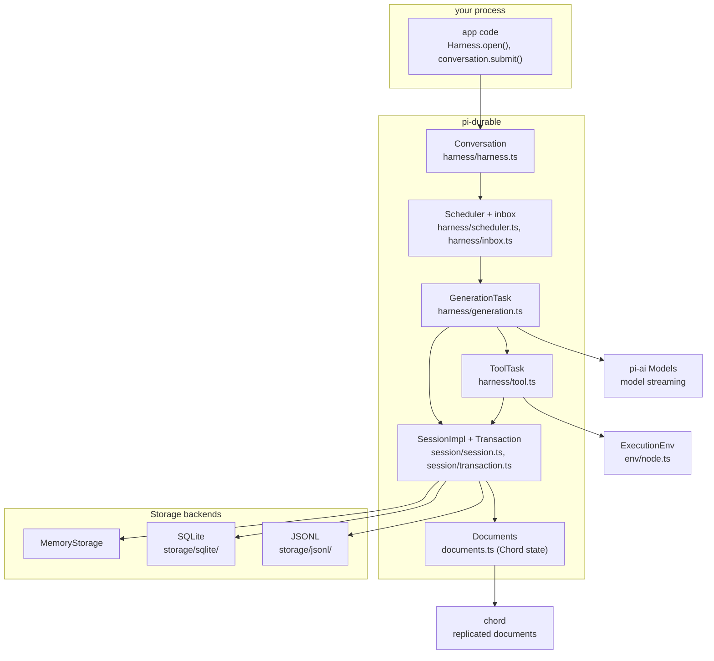
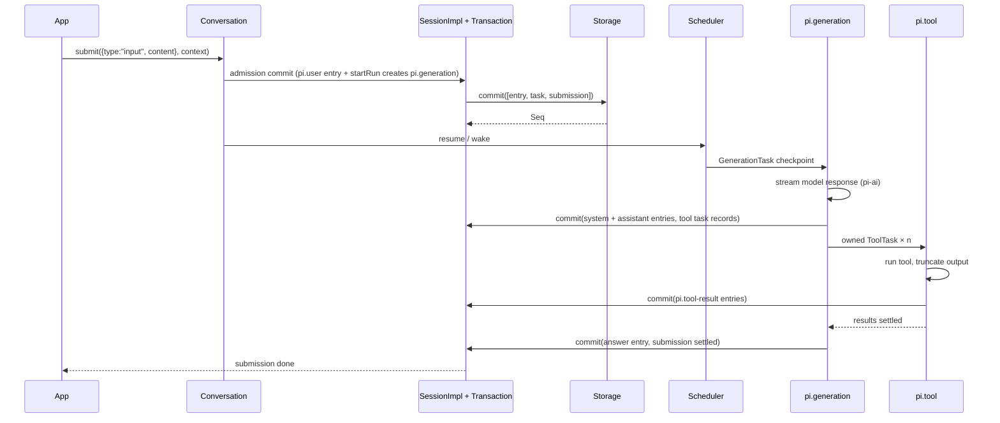
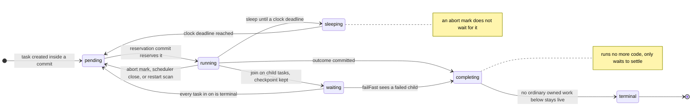
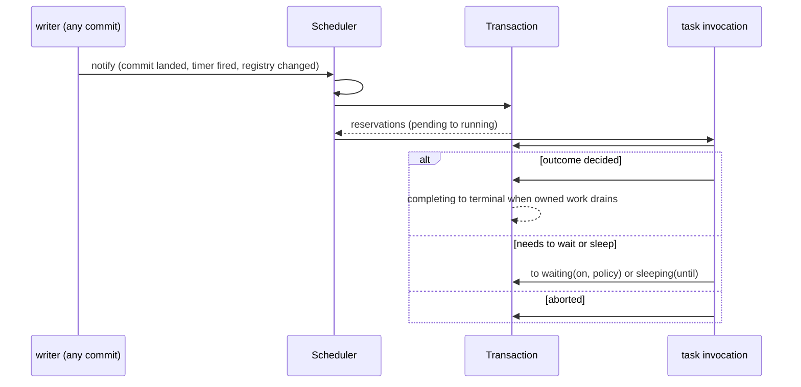

# Pi Durable Tutorial

A guided tour of the `@earendil-works/pi-durable` source: what "durable" means, how the
pieces fit together, and where in `src/` each behavior lives.

- [README.md](../README.md) is the user-facing guide: how to open a Harness, submit
  inputs, install extensions, pick storage.
- [spec.md](spec.md) is the normative specification (13 sections). This tutorial links
  into it wherever a rule is authoritative.
- This document is the *code* map: files, symbols, and control flow.

Paths below are relative to `packages/durable/`.

## 1. Run it first

From the repository root, on a fresh clone:

```bash
npm install --ignore-scripts        # install workspace dependencies
npm run hydrate:model-data          # generate the gitignored provider model data
npm run build                       # build every package in dependency order
cd packages/durable
node --conditions=source --experimental-strip-types test/examples/14-chat.ts
```

Expected output:

```text
answer: [ { type: 'text', text: 'Paris.' } ]
transcript: [ 'pi.user', 'pi.system', 'pi.assistant' ]
```

Two verified gotchas on that path:

- `packages/ai/src/providers/data/` is in `.gitignore`, so a fresh clone cannot build
  `pi-ai` until `npm run hydrate:model-data` runs. Until then `npm run build` fails in
  `check:model-data` with `amazon-bedrock.json is not valid JSON`.
- `pi-durable` exports carry a `"source"` condition, but `pi-ai` does not — its `./models`
  export is only `{ types, import }` pointing at `dist/`. So `--conditions=source` runs
  durable from source while `pi-ai` and `chord` still resolve to their builds. Running the
  example before `npm run build` fails with
  `Cannot find module '.../pi-ai/dist/models.js'`.

`test/examples/` holds 32 runnable examples (`00-conversation.ts` through
`31-reload-and-restart.ts`). Start with `00`–`06` for the layers, `14`–`19` for the
harness in use, `22`–`25` for subagents and compaction. Examples that call a real model
need `OPENAI_API_KEY`; the rest use the faux provider.

## 2. What "durable" means here

The package's own summary: conversations, model turns, tool calls, and your state are
committed to storage *before* anything is shown. If the process dies mid-turn, reopening
the storage picks the work up where it stopped.

The specification states it as one rule, in the unheaded intro at `spec.md` lines 41–44, just before [§1 Terms and invariants](spec.md#1-terms-and-invariants):

> A Session atomically commits immutable entries, full task records, and Chord-tracked
> documents. Only committed state is observable.

Four consequences, each with the code that enforces it:

| Consequence | Enforced by |
| --- | --- |
| A commit is all-or-nothing across entries, tasks, and documents. | `Storage.commit(writes, context)` returns one `Seq` for the whole batch (`src/types.ts`, interface `Storage` line 1168). |
| Nothing publishes before it is stored. | `src/session/transaction.ts` — `class Transaction implements Tx` (line 194) prepares the batch; document updates publish only after the commit resolves. |
| The Session serializes commits on one mutation line. | `src/session/session.ts` — `createSession()` (line 76) builds `SessionImpl` (line 121); `HarnessImpl extends SessionImpl` (`src/harness/harness.ts` line 184). |
| A storage error is fatal rather than retried. | Documented on the `Storage` interface itself (line 1163) and in [README §Errors](../README.md#errors); surfaces as `SessionFailed` from `src/errors.ts`. |

Because everything observable is committed, restart behavior is not a special mode: the
same reads that serve a live process serve a reopened one.

## 3. Concepts and where they live

| Concept | Meaning | Definition |
| --- | --- | --- |
| **Harness** | One open storage plus the machinery that runs agents on it. | `Harness.open()` in `src/harness/harness.ts` line 486; `class HarnessImpl extends SessionImpl` line 184. |
| **Session** | Owner of the mutation line: conversations, entries, tasks, submissions, documents. | `createSession()` / `class SessionImpl` in `src/session/session.ts`. |
| **Conversation** | A transcript scope. `root()` creates the root on first use; handles hold no state and compare by `id`. | `class ConversationImpl` in `src/harness/harness.ts` line 91 implementing `Conversation` (`src/harness/types.ts` line 712); `ConversationId` and `ROOT_CONVERSATION_ID = 1` in `src/types.ts`. |
| **Entry** | One immutable transcript record. The model sees entries from the newest reset onward. | `src/entries.ts` (kinds) and `EntryRecord` in `src/types.ts` line 423. |
| **Commit** | An atomic write. `conversation.commit((tx) => ...)` can append entries, edit documents, and create tasks together. | `src/session/transaction.ts`; `Tx` in `src/types.ts` line 899. |
| **Document** | Typed JSON state stored next to the transcript, changed inside commits. | `defineDoc()` in `src/documents.ts` line 54; built-ins listed in §7. |
| **Task** | A durable state machine that saves a checkpoint per step, so a restarted process continues from the last one. | `defineTask()` in `src/tasks.ts`; `TaskDefinition`/`TaskRecord` in `src/types.ts`. |
| **Submission** | Something handed to a conversation — user input or an entry to write — that you can wait for. | `SubmissionRecord` in `src/types.ts` line 469; `src/harness/submissions.ts`. |
| **Turn / run** | A turn is one model response and its tool calls; a run is the turns from an admitted input to the final answer. A conversation is busy while a run is active. | `src/harness/scheduler.ts` (2,368 lines — the run machinery) and `src/harness/inbox.ts`. |
| **Extension** | A named bundle of tools, system prompt sections, hooks, wrappers, and tasks. | `defineExtension()` in `src/harness/define.ts`. |
| **Registry** | The extensions this process installed; it may change while the Harness runs. | `createRegistry()` and `BUILTIN_TASKS` in `src/harness/registry.ts`. |
| **Agent** | What a conversation runs with: model, thinking level, extensions, tools, instructions, working directory. Stored per conversation as names in `pi.agent`, resolved against the registry at each use. | `AgentDoc` in `src/harness/agent.ts` line 43. |

The README draws the same flow, and it matches the task names in source:

```text
submit(input) → pi.user
  pi.generation → pi.system (only if the prompt or tools changed), pi.assistant (tool calls)
    pi.tool × n → pi.tool-result × n   (owned by the generation, which waits for them)
  pi.generation → pi.assistant (answer) → submission done
```

`pi.generation` is declared at `src/harness/generation.ts` line 122, `pi.tool` at
`src/harness/tool.ts` line 124, `pi.compaction` at `src/harness/compaction.ts` line 113.

## 4. Architecture



Three boundaries worth internalizing:

- **The Harness runs tasks; the Session owns storage.** `HarnessImpl` extends
  `SessionImpl`, so harness-level operations (`root()`, `conversation()`, `usage()`) and
  session-level commits are the same object graph.
- **Chord owns document replication, durable owns meaning.** Documents are declared with
  `defineDoc<T>()` (`src/documents.ts`), stored by the Session, and exposed to Chord as
  operations — [spec.md §3 Documents](spec.md#3-documents),
  [§9 Document observation and Chord](spec.md#9-document-observation-and-chord).
- **`pi-ai` is called only from tasks.** Model streaming and tool execution are
  `pi.generation` and `pi.tool` checkpoints, which is why an interrupted turn resumes.

## 5. The write path

One submitted input, and who commits what:



Rules the scheduler and tasks implement — [spec.md §4 Transactions](spec.md#4-transactions-and-storage-ownership),
[§5 Tasks](spec.md#5-tasks), [§6 Submissions and inbox](spec.md#6-submissions-and-inbox):

- A generation *owns* the tool tasks of its calls, waits for them, and hands the run to
  the next generation. Ownership is `TaskOwnership` / `ConversationOwnership`
  (`src/types.ts` lines 364 and 389).
- External effects never run inside the transaction (invariant 4 in
  [spec.md §1](spec.md#1-terms-and-invariants)); model calls and tools are tasks that
  commit results afterwards.
- Retrying a submission with the same `requestId` returns the existing submission —
  `Storage.submissionByRequest(conversationId, requestId, context)`.
- `harness.resume()` (`src/harness/harness.ts` line 268) starts the scheduler over work
  the last process left pending; submitting or waiting starts it too.

## 6. Code map

### Root modules

| File | Lines | What it is |
| --- | ---: | --- |
| `src/types.ts` | 1,263 | Every shared record: branded IDs, `EntryRecord`, `TaskRecord`, `SubmissionRecord`, `DocumentRecord`, `StorageWrite`, `Tx`, `Storage` (line 1168), queries and pages. Start here when a type name confuses you. |
| `src/entries.ts` | 34 | The six built-in entry kinds, created with `defineEntry<D>(kind)` and narrowed by their `is()` guard. |
| `src/documents.ts` | 208 | `defineDoc()` (line 54) and `defineDocFamily()` (line 75), plus address resolution, scope checks, and `materializeDocument()`. |
| `src/tasks.ts` | 8 | `defineTask()` — types a `TaskDefinition` into a `Task`. |
| `src/search.ts` | 85 | BM25 tool search for `searchTools()` / the `tool_search` tool; a deliberate copy of the coding agent's ranking. |
| `src/truncate.ts` | 174 | Tool-output truncation: 2,000-line and 50 KB limits, whichever hits first; never returns partial lines. |
| `src/timers.ts` | 79 | `SetTimer` implementation, including Cloudflare Workers hibernation handling. |
| `src/ids.ts` | 11 | `idFromNumber()` / `seqFromNumber()` — the two trusted boundaries where ID brands are applied. |
| `src/errors.ts` | 57 | `SessionFailed`, `StorageRequestError`, `ConversationBusy`, `ReadAfterWrite`. |
| `src/index.ts` | 215 | The package's public surface, grouped by source file. |

### `src/harness/` — running agents

| File | Lines | Role |
| --- | ---: | --- |
| `harness.ts` | 511 | `class Conversation` (line 95), `class HarnessImpl extends SessionImpl` (line 184), `Harness.open()` (line 486). |
| `scheduler.ts` | 2,368 | The run engine: which tasks run, when they wake, what blocks them (`BlockedReason`). |
| `tool.ts` | 947 | `ToolTask` (`name: "pi.tool"`): tool execution, argument validation, nested tool calls, diagnostics. |
| `generation.ts` | 762 | `GenerationTask` (`name: "pi.generation"`): streams a model response, opens tool tasks, owns the run. |
| `types.ts` | 896 | Harness-local types: `HarnessOptions`, `Settings`, `Extension`, `ToolRegistration`, `ToolExecutionApi`, hooks, `ContextView`. |
| `events.ts` | 506 | `AgentEvent` / `AgentEventStream` and `watchEvents()` — the observation stream a UI attaches to. |
| `compaction.ts` | 480 | `CompactionTask` (`name: "pi.compaction"`) and `CompactionPolicy`. |
| `agent.ts` | 353 | `AgentDoc` (`pi.agent`, line 43), `configure()`, default policies (`DEFAULT_RESTART_LIMIT`, `DEFAULT_RETRY_POLICY`, …). |
| `context.ts` | 333 | Reads the model context: `readContext()`, `readContextFrom()`, `deriveContext()`, and `captureContextBounds()` over an entry range. |
| `task-graph.ts` | 299 | `TaskGraph` — the live tree of running tasks and their owners. |
| `live.ts` | 268 | `LiveDoc` (`pi.live`, line 111): what is running right now — generation message, tool slots. |
| `view.ts` | 267 | `ConversationView` — the materialized view handed to renderers. |
| `submissions.ts` | 241 | Admitting a submission and moving it through queued → placed → settled. |
| `inbox.ts` | 168 | `InboxDoc` (`pi.inbox`, line 21): steers and follow-ups queued while busy. |
| `prompt.ts` | 158 | Assembles the system prompt from extension sections. |
| `registry.ts` | 114 | `createRegistry()`; `BUILTIN_TASKS = [GenerationTask, ToolTask, CompactionTask]` (line 10). |
| `usage.ts` | 72 | `UsageDoc` (`pi.usage`, line 15): spend accounting. |
| `define.ts` | 44 | `defineExtension`, `defineTool`, `section`, `hook`, `wrapTool`, `wrapSection`. |
| `json.ts` | 32 | `assignJson()` — assigns a partially streamed message leaf by leaf so each flush does not store and publish the whole object. |
| `util.ts` | 67 | `class Waiters`, `closedError()`, `optionalExtension()`, `scanAll()`. |
| `provider.ts` | 39 | `ProviderDoc` (`pi.provider`, line 13): the conversation's persisted provider session identity (UUIDv7). |

### `src/session/` and `src/storage/`

| File | Lines | Role |
| --- | ---: | --- |
| `session/session.ts` | 1,107 | `createSession()` (line 76), `class SessionImpl implements Session` (line 121): the mutation line, reads, commit serialization, close/failure handling. |
| `session/transaction.ts` | 1,043 | `class Transaction implements Tx` (line 194): one atomic batch — entries, task records, document changes. |
| `session/observation.ts` | 292 | Watches over conversations, entries, and documents. |
| `session/forks.ts` | 97 | Forking a conversation at an entry. |
| `storage/memory.ts` | 864 | `MemoryStorage` — nothing persisted; the reference implementation and the fastest for tests. |
| `storage/jsonl/storage.ts` | 846 | Append-only files in one directory; keeps history in memory too, so memory grows with it. |
| `storage/sqlite/storage.ts` | 957 | SQLite backend: WAL, `synchronous = NORMAL`, table prefix support. |
| `storage/sqlite/migrations.ts` | 138 | Schema migrations. |
| `storage/scan.ts` | 40 | Shared scan/cursor helpers. |

### The rest

| Path | Role |
| --- | --- |
| `src/tools/` | `read`, `write`, `edit`, `bash` (plus `powershell`, image support). `createCodingTools()` returns the `coding-tools` extension; `CodingTools` is it without an image processor (`src/tools/index.ts` line 31). Nothing installs it automatically. |
| `src/tool-search/` | The `tool_search` tool over `src/search.ts`. |
| `src/env/` | `ExecutionEnv` — `index.ts` (377) is the interface (`FileSystem` + `Shell`), `node.ts` (1,226) the Node implementation, `node-watch.ts` (522) file watching. The separate `packages/env` (`@earendil-works/pi-env`) supplies a local and an SSH-daemon remote implementation of the same contract; pi-durable never imports it. |
| `src/codemode/` | `codemode.ts` (1,039): "durable code mode" — model-written JavaScript in a QuickJS sandbox whose script survives a restart, with task-scoped `pi.codemode.run` and `pi.codemode.journal` documents. |
| `src/images/` | Image decoding/preparation for the `read` tool, with Node and Cloudflare variants. |
| `src/testing/` | `storage-conformance.ts` (1,682) — `registerStorageConformance()` lets any backend run the same suite; plus `env-conformance.ts` and `storage-benchmark.ts`. |

## 7. The entry model

An entry is an immutable transcript record. The six built-in kinds, all from
`src/entries.ts`:

| Kind | `model` payload | Written by |
| --- | --- | --- |
| `pi.user` | `[UserMessage]` | submissions |
| `pi.assistant` | `[AssistantMessage]`, any stop reason | generation |
| `pi.system` | `[SystemMessage]` with empty `content` — position and tool changes | generation (when prompt or tools changed) |
| `pi.tool-result` | `[ToolResultMessage]`, content ending with the rendered diagnostics block; structured diagnostics in `data` | tool tasks, and generation for calls it did not offer |
| `pi.reset` | absent, or `[UserMessage]` carrying handoff text; always `head: "self"` | `Conversation.reset()` and the `handoff` tool control |
| `pi.compaction` | `[UserMessage]` wrapping the summary, `head` = first kept entry | compaction tasks |

`EntryRecord` (`src/types.ts` line 423) is what storage holds:

```ts
type EntryRecord = {
  readonly id: EntryId;
  readonly conversationId: ConversationId;
  readonly kind: string;              // application-defined discriminator
  readonly model?: readonly Message[]; // messages sent to the model
  readonly data?: JsonValue;           // payload for views/extensions/bookkeeping
  readonly head?: EntryId;             // first entry of the active context
  readonly edits?: readonly ContextEdit[]; // context-only overrides of earlier entries
  readonly byTaskId?: TaskId;          // set when durable work produced it
};
```

The `head` and `edits` fields are how compaction and context editing work without
mutating history: `head` marks where the active context starts, `edits` replaces or omits
an earlier entry's contribution to model context. Entries and IDs are never reused
after a commit (invariant 5, [spec.md §1](spec.md#1-terms-and-invariants)).

Custom kinds are just `defineEntry("myapp.foo")` — the model never sees `kind` or `data`,
only `model`.

## 8. Documents

```ts
export const AgentDoc = defineDoc<AgentState>({ kind: "pi.agent", /* scope and defaults */ });
```

`defineDoc<T>()` (line 54) and `defineDocFamily<T, I>()` (line 75) return typed tokens;
the *definition* carries the kind, scope, initial value, and semantics. Scopes are
`"session"`, `"conversation"` (root, or a point in a conversation's history), and `"task"`
(`SessionDocToken`, `ConversationDocToken`, `TaskDocToken` in `src/types.ts` lines
104–113).

The five built-in documents:

| Document | Declared in | Holds |
| --- | --- | --- |
| `pi.agent` | `src/harness/agent.ts` line 43 | The conversation's agent choices, stored as names and resolved against the registry per use. |
| `pi.provider` | `src/harness/provider.ts` line 12 | Provider-facing session identity (a persisted UUIDv7 forwarded to pi-ai as `sessionId`). |
| `pi.live` | `src/harness/live.ts` line 111 | What is running: generation message, tool slots, nested call summaries. |
| `pi.inbox` | `src/harness/inbox.ts` line 21 | Queued submissions, steers, and follow-ups. |
| `pi.usage` | `src/harness/usage.ts` line 14 | Spend. |

Your own state is declared the same way and committed in the same transaction as entries:
`conversation.commit((tx) => { tx.append(...); tx.update(myDoc, ...); })`. Values assigned
into a draft are copied by value and must be strict JSON, and drafts are revoked when the
callback settles (invariant 6).

## 9. Tasks and recovery

```ts
export function defineTask<I, S extends { phase: string }, R, H extends object = object>(
  definition: TaskDefinition<I, S, R, H>,
): Task<I, S, R, H> {
  return { definition };
}
```

A task is a state machine over `phase`s, and every phase boundary is a checkpoint. That
single design choice produces the recovery story:

- `Harness.open()` verifies the registry contains the built-in tasks
  (`harness.ts` line 495: `BUILTIN_TASKS = [GenerationTask, ToolTask, CompactionTask]`),
  then `openTasks(context)` reopens whatever was pending.
- `harness.resume()` (line 268) starts the scheduler over interrupted work. A run left
  half-finished by a crash continues from its last checkpoint.
- Whether an interrupted tool may run again is declared per tool: `replay:
  "safe" | "unsafe"` on `ToolRegistration` (`src/harness/types.ts` line 303, default
  `unsafe`). Replay-safe tools rerun after a crash; a tool marked unsafe is abandoned on
  restart rather than re-executed.
- A task that waits for time ends its phase asleep; the sleep is stored, so it holds no
  invocation, survives restarts, and resumes when the clock reaches `until`
  ([README §Sleeping and Waking Up](../README.md#sleeping-and-waking-up)).
- `harness.taskGraph(context)` / `watchTaskGraph()` expose the live owner tree.
- Ownership decides failure propagation: `JoinPolicy` is `"failFast"` or `"allSettled"`
  (`src/types.ts` line 367).

Storage choice matters here — [README §Storage](../README.md#storage):

| Backend | Import | Trade-off |
| --- | --- | --- |
| Memory | `MemoryStorage` from the package root | Nothing persists. |
| SQLite | `openNodeSqliteStorage(file)` from `storage/sqlite/node` | One file; WAL + `synchronous = NORMAL` survives process crashes. |
| JSONL | `openNodeJsonlStorage(dir, context)` from `storage/jsonl/node` | Append-only directory; `{ fsync: true }` flushes before each commit. Keeps all history in memory — prefer SQLite for long-running agents. |
| Durable Object | `openDurableObjectSqliteStorage(ctx.storage)` from `storage/sqlite/cloudflare` | Commits are the DO's storage transactions. |

The portable cores (`storage/sqlite`, `storage/jsonl`) run without Node APIs — Bun or
Cloudflare Workers — given a `SqliteDatabase` facade or a `FileSystem` from
`src/env/`. One process owns a storage at a time; there is no cross-process locking.

Custom backends must run the conformance suite:

```ts
import { registerStorageConformance } from "@earendil-works/pi-durable/testing";
registerStorageConformance({ describe, expect, it }, "My Storage", async (use) => {
  const storage = await openMyStorage();
  try { await use(storage); } finally { await closeMyStorage(storage); }
});
```

## 10. The task state machine

Everything else in this package exists to move a task record between six committed states. The
states are not an enum of convenience — each carries the fields that make it resumable, and the
union in `types.ts:592–636` is the authority:



| State | Carries | Leaves when |
|---|---|---|
| `pending` | `checkpoint` | A reservation commit claims it (`status: "running"`, scheduler.ts:1510) |
| `running` | `checkpoint` | Outcome, join, sleep, abort, close, or a restart scan (`scheduler.ts:373`, `509`, `1729`) |
| `waiting` | `checkpoint`, `on`, `policy` | Every task in `on` is terminal — or `failFast` sees one fail |
| `sleeping` | `checkpoint`, `until` | The `HarnessOptions.now` clock reaches `until`; an abort does not wake it |
| `completing` | `outcome` | No ordinary owned work below it is live (`scheduler.ts:1806`, `844`) |
| `terminal` | `outcome` | Never; this is the durable receipt (`scheduler.ts:1809`) |

`LIVE_STATUSES` (scheduler.ts:58) is the five non-terminal states, and it is what every recovery
scan iterates. Two consequences worth internalizing:

- **`completing` is a barrier, not a formality.** A task whose outcome is decided still waits for
  its ordinary owned children to settle, so a parent never becomes `terminal` while a child can
  still write. Background children are excluded from that wait by design.
- **`running` is only ever in memory.** It means "one in-memory invocation reserved this", which is
  why a crash leaves records in `running` and the next open must reinterpret them
  (scheduler.ts:370–375). A clean `close()` writes them back to `pending` and deliberately does not
  count a restart — the comment at scheduler.ts:502–506 is explicit that *"a close is not a crash"*.
  A task that exceeds the restart limit is parked, reported by `blockedReason()` as
  `"restart_limit"`, and only `retry()` clears the count.

## 11. Inside the scheduler: one pass

`scheduler.ts` is 2,368 lines because each of these phases has to be crash-safe, but the shape of a
pass is small: something becomes dirty, the scheduler drains, a reservation commit claims work, and
each claimed task is stepped inside its own transaction.



The pieces, in the order a reader should look at them:

| Phase | Function | What it guarantees |
|---|---|---|
| Recovery | `#reconcile` (scheduler.ts:753) | Rebuilds in-memory indexes from a scan of `LIVE_STATUSES`; reinterprets `running` records; schedules `failFast` checks |
| Trigger | `#kick` / `#drain` (scheduler.ts:1413) | Coalesces wakeups; a wakeup that arrives after the last check re-kicks itself |
| Reservation | `#reserve` (scheduler.ts:1433) | Claims every eligible task **in one commit**, so two scheduler instances cannot both claim |
| Execution | `#run` (scheduler.ts:1673) | Runs the definition; owns abort handling and restart counting |
| Progress | `#step` (scheduler.ts:1767) | Commits checkpoints, writes, and state transitions together |
| Settling | `#terminate` (scheduler.ts:1803) | `completing` first, `terminal` when the subtree drains |

`blockedReason()` (scheduler.ts:425) is the other half of the story: it answers *why not* for
status UIs — `"restart_limit"`, a missing or too-old definition, a failed migration — and returns
`undefined` for tasks that are running, abort-marked, or already holding an outcome.

## 12. Failure, in one paragraph per rule

From [README §Errors](../README.md#errors) and [spec.md §10.1](spec.md#10-storage-contract):

1. **A storage error ends the Harness.** Nothing is retried. Every backend call passes
   through `GuardedStorage` (`src/session/session.ts` line 945), which latches the first
   failure; afterwards everything rejects with `SessionFailed`, watches end with `session_failed`, pending tasks get their abort
   signal. Reopen: commits are atomic, so the store is consistent, and a resubmission with
   the same `requestId` finds a submission that already landed. `harness.closed` settles
   when the close is done, and `end.reason === "failed"` is your restart trigger.
2. **An invalid read fails only that call.** `StorageRequestError` for a bad cursor or an
   unknown conversation has no durable effect. The exemption covers reads only: any error
   from `commit()` or `mintId()` ends the Harness.
3. **Your code fails only its own unit.** A throwing phase faults that task; a throwing
   tool returns an error result; a throwing hook is reported and skipped (`beforeTool`
   blocks the call); a throwing commit callback rolls back that commit. The exception is a
   `RegistryReader.snapshot()` that throws — without a registry the Harness cannot
   schedule, so that fails everything.

## 13. The extension surface

```ts
import { defineExtension, defineTool, section, hook, wrapTool, wrapSection } from "./harness/define.ts";

export function defineExtension<Tool extends ToolRegistration = ToolRegistration>(
  extension: Extension<Tool>,
): Extension<Tool> {
  return extension;
}
```

An extension bundles:

| Piece | Declared with | Purpose |
| --- | --- | --- |
| Tools | `defineTool({ name, parameters, execute })` | Model-callable tools. |
| Prompt sections | `section(key, render, { tag })` | System-prompt contributions, orderable and wrappable. |
| Hooks | `hook(task, handlers)` | Observe or block a task's phases and tool calls. |
| Wrappers | `wrapTool(tool, wrapper)`, `wrapSection(key, wrapper)` | Replace or decorate a tool or section *wherever the wrapping extension is selected*. |
| Tasks | `defineTask()` registered in the registry | New durable state machines. |

Selection is per conversation: the agent's extension names live in `pi.agent`, resolved
against the registry at each use, so `configure()` can swap them mid-run
([README §Extensions](../README.md#extensions), example
`27-plan-mode.ts`). A `Registry` may change while the Harness runs — new work picks up
the new state.

The coding tools are the template to copy:

```ts
export function createCodingTools(options: ReadToolOptions = {}) {
  return defineExtension({
    name: "coding-tools",
    tools: [createReadTool(options), createWriteTool(), createEditTool(), createBashTool()],
  });
}
```

## 14. Where to work on what

| Task | Start here |
| --- | --- |
| Understand a record type | `src/types.ts`, then the section of [spec.md](spec.md) named for it. |
| Change when a run proceeds or blocks | `src/harness/scheduler.ts`. |
| Change model streaming or tool-call handling | `src/harness/generation.ts` and `src/harness/tool.ts`. |
| Add a built-in entry kind | `src/entries.ts`, plus the reader in `src/harness/context.ts`. |
| Add a document | `defineDoc()` in `src/documents.ts`, declare it where it is used, read it in the task that needs it. |
| Add a tool | `src/tools/` (follow `createReadTool`), expose it through an extension. |
| Support a new storage backend | Implement `Storage` from `src/types.ts`, then run `registerStorageConformance`. |
| Work on prompt assembly | `src/harness/prompt.ts` and `src/harness/context.ts`. |
| Change the TUI-facing view/events | `src/harness/view.ts`, `src/harness/events.ts`. |
| Compare with the single-process equivalent | [../coding-agent/docs/codebase-tutorial.md](../../coding-agent/docs/codebase-tutorial.md) — the same agent loop without durability. |

## Related documentation

- [README](../README.md) — usage: concepts, persist/resume, extensions, storage, errors.
- [Specification](spec.md) — normative: terms and invariants, core records, documents,
  transactions, tasks, submissions, extensions, built-in tasks, Chord, storage contract,
  backends, footguns, non-goals.
- [Pi codebase tutorial](../../coding-agent/docs/codebase-tutorial.md) — the language,
  packages, and agent loop that durable builds on.
- `test/examples/` — runnable slices of every concept above.
