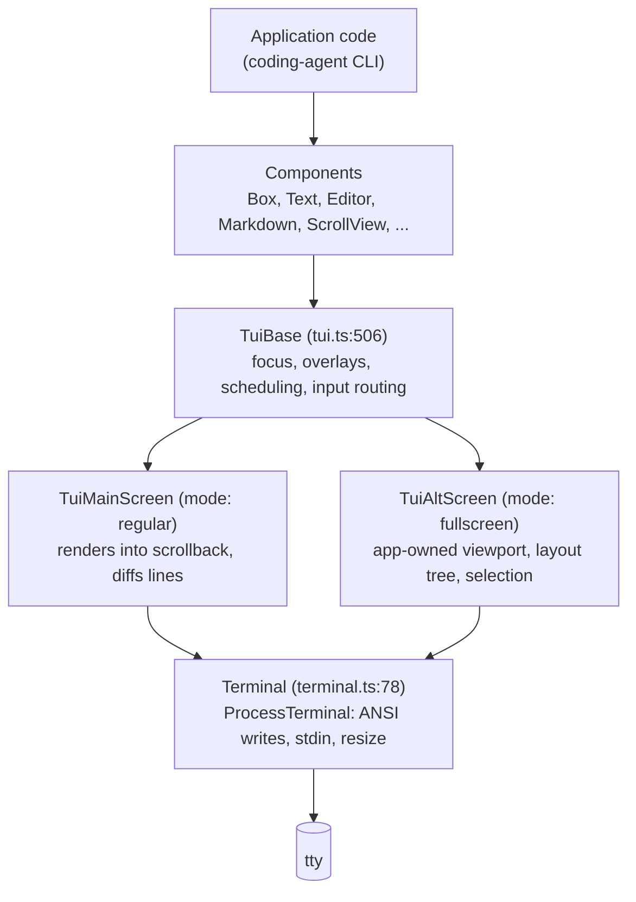
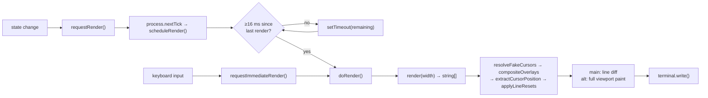
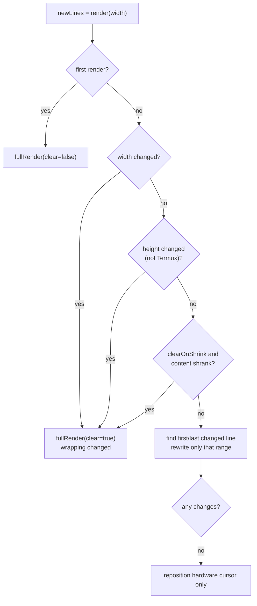
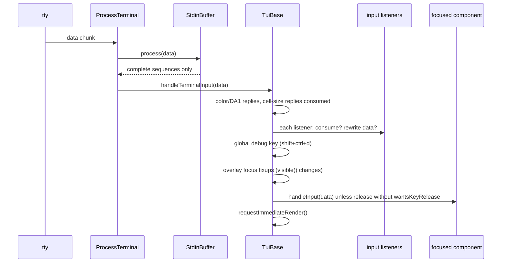
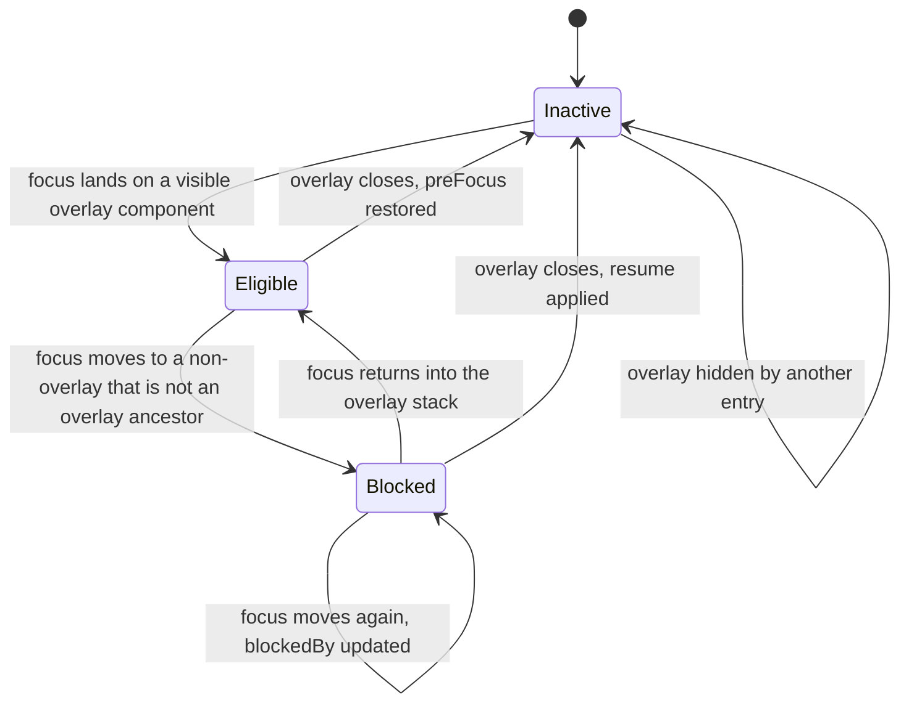
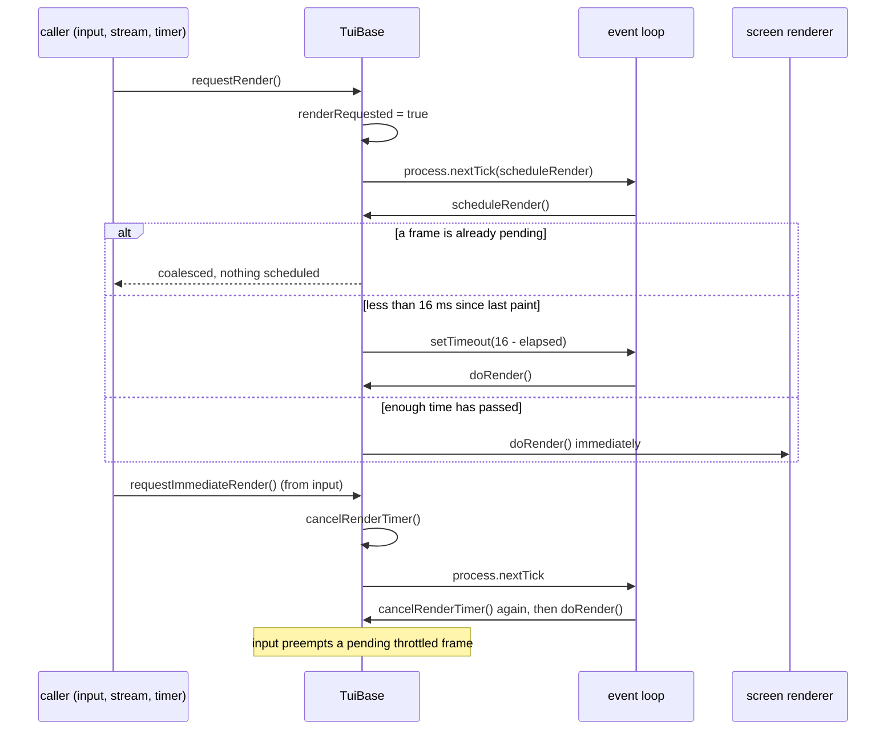

# Pi TUI: a Code Map

`@earendil-works/pi-tui` is the terminal UI library under everything you see in the
`pi` CLI. Its package description is precise about the design goal: *"Terminal User
Interface library with differential rendering for efficient text-based applications."*
This page maps the code: the component contract, the render pipeline, the two screen
modes, the layout engine, and the input path from raw bytes to a focused component.

Newcomers usually assume a TUI library is a widget set. This one is closer to a **retained
array-of-lines renderer**: components return `string[]`, every string must be exactly the
viewport width in *visible columns*, and the runtime diffs line arrays and repaints only what
changed. Understand that and the rest of the package follows.

| | |
|---|---|
| Source | 46 files, 19,540 lines in `packages/tui/src/` |
| Runtime deps | `get-east-asian-width` 1.6.0, `marked` 18.0.11 (nothing else) |
| Tests | `node --test` on `.ts` directly — 1,045 tests, 1,043 pass, 2 skipped (~6 s) |
| Consumers | `@earendil-works/pi-coding-agent` (the CLI), and anything else that imports the barrel `src/index.ts` |

## 1. Run it first

```bash
cd packages/tui
npm test        # node --test --test-reporter=dot test/*.test.ts
```

Verified output on the current tree: **1,045 tests, 1,043 pass, 0 fail, 2 skipped** in about
six seconds. There is no terminal harness to fake: tests call `component.render(width)` and
compare line arrays, which is exactly how you should develop a component.

## 2. Architecture at a glance



`TuiBase` implements everything mode-independent — focus, the overlay stack, render
scheduling, input dispatch, color queries. The two concrete subclasses implement exactly one
abstract method each:

```ts
// tui.ts:552
protected abstract doRender(): void;
```

Everything mode-specific lives behind that line.

## 3. File map

| File | Lines | Role |
|---|---:|---|
| `src/tui.ts` | 1,517 | `Component`, `Container`, `TUI`, `TuiBase`, overlays, focus, render scheduling, input routing. |
| `src/tui-main-screen.ts` | — | `TuiMainScreen`: regular mode; line diffing against the previous frame, scrollback-safe. |
| `src/tui-alt-screen.ts` | — | `TuiAltScreen`: fullscreen mode; layout tree, viewport scrolling, mouse selection, search. |
| `src/layout.ts` | 449 | `LayoutRect`, `LayoutBox`, `LayoutFrame`, `renderLayoutFrame`, scrollbar geometry, hit testing. |
| `src/terminal.ts` | 609 | `Terminal` interface and `ProcessTerminal` (stdin/stdout, resize, Kitty protocol negotiation, OSC progress/status). |
| `src/stdin-buffer.ts` | — | Reassembles split escape sequences before key parsing. |
| `src/keys.ts` | 1,455 | `parseKey`, `matchesKey`, `Key`, Kitty keyboard protocol support. |
| `src/keybindings.ts` | — | `Keybindings` registry (declaration-mergeable), `KeybindingsManager`, `TUI_KEYBINDINGS`. |
| `src/autocomplete.ts` | — | `AutocompleteProvider`, `CombinedAutocompleteProvider`, slash commands. |
| `src/utils.ts` | — | Width/ANSI primitives: `visibleWidth`, `truncateToWidth`, `sliceByColumn`, `stripTerminalSequences`, `wrapTextWithAnsi`. |
| `src/colors.ts` | — | `Color` union (indexed / rgb / oklch), `styleText`, truecolor-vs-256 downgrade. |
| `src/oklab.ts` | — | OKLab/OKLCH/OKHSL conversions behind `colors.ts`. |
| `src/terminal-image.ts` | — | Capability detection, Kitty/iTerm2 encoding, `renderImage`, cell dimensions, hyperlinks. |
| `src/latex.ts` | — | `renderLatex`: math typeset into terminal lines. |
| `src/components/` | 18 files | The widget set — see §11. |
| `src/alt-screen-search.ts` | — | Transcript search index used by `TuiAltScreen`. |

## 4. The component contract

```ts
// tui.ts:117
export interface Component {
	/** Render the component to lines for the given viewport width */
	render(width: number): string[];
	/** Optional handler for keyboard input when component has focus. */
	handleInput?(data: string): void;
	/** Optional normalized mouse handler. */
	handleMouse?(event: TuiMouseEvent): TuiMouseEventResult | undefined;
	/** If true, component receives key release events (Kitty protocol). Default false. */
	wantsKeyRelease?: boolean;
	/** Invalidate any cached rendering state. */
	invalidate(): void;
}
```

Four rules follow from that signature, and every component in `src/components/` obeys them:

1. **`render` is pure and cheap.** It returns lines at exactly `width` visible columns —
   padding included. The runtime calls it on every frame for every mounted component, so
   components cache (see `Box`'s `RenderCache`, components/box.ts:4–9, keyed by width,
   child lines, and a background sample).
2. **`invalidate()` is the only cache-busting signal.** Theme changes and structural edits
   call it; `Container.invalidate` (tui.ts:377) recurses to children.
3. **Focus is separate from mounting.** `Focusable` (tui.ts:180) adds `focused: boolean`;
   `setFocus` flips those flags (tui.ts:598).
4. **Mouse is hit-tested by re-rendering.** `Container.handleMouse` (tui.ts:387) maps `event.y`
   to a child by summing each child's rendered height, then rewrites `y`/`height` for the
   child — the same "rendering is the source of truth" idea.

`Container` (tui.ts:358) is the only built-in composition primitive: children stack
vertically, `render` concatenates their lines, and it records `mouseLayout` as a side effect
of rendering so mouse dispatch never re-renders just for hit testing.

### Width discipline and the cursor trick

Terminal "width" is not `string.length`. `utils.ts` measures with `visibleWidth` over ANSI-stripped
text, using `Intl.Segmenter` for graphemes and `get-east-asian-width` for double-width glyphs;
`truncateToWidth` / `sliceByColumn` cut at column boundaries without splitting escape sequences
or surrogate pairs. Get this wrong and output shears on every wide character, emoji, or
hyperlink.

The cursor is rendered *inside* the line buffer with zero-width APC markers:
`CURSOR_MARKER` (tui.ts:196), `FAKE_CURSOR_START`/`FAKE_CURSOR_END` (tui.ts:199–200),
wrapped by `renderFakeCursor` (tui.ts:205). Before diffing, `resolveFakeCursors`
(tui.ts:1478) strips them and reports the position; `extractCursorPosition` (tui.ts:1453)
then produces `{row, col}` for `positionHardwareCursor` (tui-main-screen.ts:624). That is why
a focused input's caret lands in the right cell even though components only emit strings.

## 5. Render pipeline



`requestRender` (tui.ts:1001) coalesces: it sets a flag and defers to
`process.nextTick`. `scheduleRender` (tui.ts:1035) enforces
`MIN_RENDER_INTERVAL_MS = 16` (tui.ts:518) — at most ~60 fps. Input preempts that throttle via
`requestImmediateRender` (tui.ts:1012), because a typed character must not wait for a frame
in flight: the comment there notes that even `setTimeout(0)` can cost a full 16 ms tick on
Windows. `renderNow(force)` (tui.ts:993) is the escape hatch; `force` calls
`resetRenderState()` so the next paint is full.

## 6. Regular mode: diff rendering

`TuiMainScreen` (mode `"regular"`) renders into the normal screen so output stays in
scrollback. `doRender` (tui-main-screen.ts:247) is the heart of the package:

1. Render all components and resolve fake cursors (`resolveFakeCursors`).
2. Composite overlays into the line array (`compositeOverlays`, tui.ts:1350).
3. Extract the cursor position, then apply per-line resets (`applyLineResets`, tui.ts:1424).
4. Decide full vs incremental:



Details that matter in practice:

- **Termux exception:** Termux resizes when the software keyboard toggles; a full redraw
  there replays the whole history, so height changes are diffed instead
  (tui-main-screen.ts, the `isTermuxSession()` branch).
- **Append optimization:** when the only change is appended lines at the end and the first
  changed line is beyond the top (`appendStart`), the renderer writes just the new lines.
- **Synchronized output:** every full paint is wrapped in `\x1b[?2026h` … `\x1b[?2026l`, so
  terminals that support it never show a half-painted frame.
- **Bounded writes:** `BoundedTerminalWriter` (tui-main-screen.ts:16) streams output in 1 MiB
  chunks (`MAX_RENDER_WRITE_CHARS`) and never splits a surrogate pair — a long transcript can
  otherwise exceed V8's string limit.
- **Images occupy multiple rows:** Kitty image lines carry a header parsed by
  `parseKittyImageHeader`; the renderer reserves those rows and `expandChangedRangeForKittyImages`
  widens the repaint range so placements are not orphaned.

## 7. Fullscreen mode: `TuiAltScreen`

`TuiAltScreen` (tui-alt-screen.ts:202, mode `"fullscreen"`) owns the viewport: layout root,
scroll position, selection, search, and image placements. It sets the `VIEWPORT_TUI` symbol
(tui.ts:495, checked by `isViewportTUI`), which is the runtime's signal that the TUI controls
scrolling rather than the terminal.

Its layout tree comes from `layout.ts`:

```ts
// layout.ts:16-42
export interface LayoutRect { x: number; y: number; width: number; height: number; }
export interface LayoutBox {
	component: Component;
	rect: LayoutRect;
	clip: LayoutRect;
	children: LayoutBox[];
	parent?: LayoutBox;
	lines?: readonly string[];
	lineOffset?: number;
	scrollView?: ScrollView;
	scrollContentLines?: readonly string[];
	layer: number;
}
export interface LayoutFrame { root: LayoutBox; width: number; height: number; lines: string[]; primaryScrollView?: ScrollView; }
```

`renderLayoutFrame` (layout.ts:379) produces the frame once per paint; mouse and scroll
handling then use `getLayoutBoxesAt` (layout.ts:415) and `getScrollViewsAt` (layout.ts:439)
for hit testing, and `getScrollbarGeometry` (layout.ts:280) draws scrollbars from the same
rects. Selection, clipboard copy (`copyOnSelect`, `copySelection`; OSC 52 fallback), wheel
scrolling (`wheelScrollLines`, `"auto"` acceleration, Alt+wheel ×5), transcript search
(`alt-screen-search.ts`), and clickable OSC 8 links all hang off that one frame.

## 8. Input path



- `StdinBuffer` (stdin-buffer.ts) exists because an SGR mouse sequence like `\x1b[<35;20;5m`
  can arrive as three chunks; without buffering, a partial `\x1b` would be read as Escape.
- `ProcessTerminal` (terminal.ts:150) also negotiates the Kitty keyboard protocol
  (`DESIRED_KITTY_KEYBOARD_PROTOCOL_FLAGS = 7`, terminal.ts:20), resolves the escape
  reassembly window (`resolveEscapeTimeoutMs`, terminal.ts:136 — 10 ms locally, 100 ms over
  SSH), and handles Apple Terminal's Shift+Enter quirks.
- `keys.ts` exposes `parseKey` (one data string → normalized `KeyId`), `matchesKey`
  (compare against a binding like `"ctrl+shift+p"`), and the `Key` helper object. Kitty
  support adds key release events; components opt in with `wantsKeyRelease`.
- `keybindings.ts` is a declaration-mergeable registry (`interface Keybindings`), so
  coding-agent adds its own bindings without patching the library; `KeybindingsManager`
  detects conflicts, `TUI_KEYBINDINGS` holds the defaults.

`handleTerminalInput` (tui.ts:1055) is the dispatcher: terminal replies first (DA1 color
answers, cell-size answers), then input listeners in registration order (each may consume or
rewrite the data), then the global debug key, then focus repair when a focused overlay became
invisible, then the focused component.

## 9. Overlays

`showOverlay(component, options)` (tui.ts:729) pushes onto `overlayStack`; `hideOverlay`
(tui.ts:829) pops. `OverlayOptions` (tui.ts:254) covers sizing (`width`, `minWidth`,
`maxHeight` as numbers or `"50%"`), anchoring (`anchor`, `offsetX/Y`, `row`, `col`), margins,
a per-render `visible(termWidth, termHeight)` predicate, and `nonCapturing` for
non-focusable popups. Overlay content is spliced into the base line with
`compositeTuiLine` (tui.ts:426), which slices ANSI-aware segments and re-pads — not a second
render pass.

Focus restoration is the subtle part: when an overlay closes, focus returns to whatever was
focused before, unless something else grabbed focus meanwhile — hence the
`overlayFocusRestore` state machine (`eligible` / `blocked` / `inactive`, tui.ts:530–690).

## 10. Two state machines under the API

`setFocus` looks like an assignment. It is actually a four-state machine that exists so closing an
overlay puts the cursor back where the user left it — even if focus wandered while the overlay was
open.



The three states are literally the union at `tui.ts:343–352`:

| State | Meaning | Payload |
|---|---|---|
| `inactive` | Nothing to restore. | — |
| `eligible` | Focus is inside a visible overlay; closing it should restore `preFocus`. | `overlay` |
| `blocked` | Focus left the overlay for something else; closing must consult `resume`. | `overlay`, `blockedBy`, `resume` |

`resume` is the interesting field: `{ status: "restore-overlay" }` means "the overlay is still what
the user was working in, put focus back there", while `{ status: "focus-target" }` means "focus was
deliberately moved to this component, honour it" (`resolveBlockedOverlayFocusResume`, tui.ts:677).
Two supporting rules keep it honest: focus moving *within* the overlay's ancestry is not a block
(`isOverlayFocusAncestor`, tui.ts:692), and the whole state is re-validated on read — if the entry
is no longer in the stack or no longer visible, `getVisibleOverlayFocusRestore` reports `inactive`
(tui.ts:683–690). A stale restore can therefore never resurrect a dead overlay.

### Frames: three ways in, one way out

Every repaint in a regular-mode TUI goes through `doRender`. What differs is *when*:



| Entry point | Behaviour | Used by |
|---|---|---|
| `requestRender()` (tui.ts:1001) | Coalesces: sets `renderRequested`, schedules on `nextTick`. Returns immediately if a frame is already requested. | Components, streaming updates |
| `requestRender(true)` | `resetRenderState()` then immediate — full repaint. | Theme change, resize |
| `requestImmediateRender()` (tui.ts:1012) | Cancels the timer and paints on `nextTick`, re-cancelling because a queued `scheduleRender` may have armed one. | Input handlers |
| `renderNow()` (tui.ts:993) | Synchronous paint; optional `force` resets cached state first. | Startup, teardown, alt-screen switches |

The double `cancelRenderTimer()` in `requestImmediateRender` is the whole reason keystrokes feel
instant on a busy screen: the comment at tui.ts:1020–1021 spells out that a previously queued
`scheduleRender()` can create a timer before the `nextTick` callback runs, and user input has to
preempt that frame. The 16 ms budget itself is `MIN_RENDER_INTERVAL_MS`, enforced as
`max(0, 16 - elapsed)` in `scheduleRender` (tui.ts:1040).

## 11. Components

| Component | Lines | What it does |
|---|---:|---|
| `Editor` | 2,473 | Multi-line editor: grapheme-aware cursor, history, kill-ring, undo stack, word navigation. |
| `Markdown` | 1,025 | Markdown → styled lines via `marked`, with themes and inline code/emphasis. |
| `Input` | 501 | Single-line input with horizontal scrolling. |
| `SettingsList` | 328 | Settings menu with sections and editing affordances. |
| `SelectList` | 273 | Selecting from items, with layout/truncation options. |
| `ScrollView` | 224 | Scrollable region with scrollbar and follow-end behavior. |
| `Box` | 172 | Padding + background container (the reference implementation of the contract). |
| `Image` | 167 | Base64/PNG model input rendered through the terminal image protocol. |
| `Stack` | 154 | Base stacking layout helpers. |
| `Text` | 113 | Multi-line text with word wrapping. |
| `Loader` | 101 | Spinner with optional animation. |
| `TruncatedText` | 65 | Single-line, width-truncating text. |
| `AltScreenFlashContainer` | 51 | Brief highlight used when jumping to a search match. |
| `HStack` / `VStack` | 44 / 33 | Horizontal / vertical stacking. |
| `CancellableLoader` | 40 | Loader cancelled with Escape. |
| `MouseRegion` | 33 | Declares a mouse-interactive rectangle. |
| `Spacer` | 28 | Empty lines. |

Read `components/box.ts` (172 lines) first: it is the smallest complete component with a
render cache, mouse routing, and background painting.

## 12. Colors, images, math

- `colors.ts` models color as a discriminated union — `IndexedColor` (256-color index),
  `RgbColorValue`, `OklchColorValue` — and `styleText` emits the right escape for the target
  mode (`TerminalColorMode`). OKLCH/OKHSL math lives in `oklab.ts`; mixing happens in a
  perceptual space, not sRGB.
- `terminal-image.ts` detects capabilities once (`detectCapabilities` →
  `TerminalCapabilities { images: "kitty" | "iterm2" | null, trueColor, hyperlinks }`),
  encodes with `encodeKitty` / `encodeITerm2`, and falls back through `imageFallback`.
  Row reservation in both screen modes depends on `getCellDimensions` / `calculateImageRows`.
- `latex.ts` exposes `renderLatex` for math, so formulas render as terminal lines rather
  than an image dependency.

## 13. Contracts worth memorizing

| Contract | Where | Consequence if broken |
|---|---|---|
| Every line returned by `render(width)` must be exactly `width` visible columns | tui.ts:117 | Diff writes drift; borders shear; cursor lands in wrong cell. |
| Measure with `visibleWidth`, never `string.length` | utils.ts | Wide chars, emoji, and ANSI codes break layout. |
| Call `invalidate()` when cached render state changes | tui.ts:140 | Stale frames until the next width change. |
| One `doRender()` per screen mode; scheduling lives in `TuiBase` | tui.ts:552 | Duplicate render loops and flicker. |
| Input must preempt the 16 ms throttle | tui.ts:1012 | Typing feels laggy on Windows/slow terminals. |
| Overlays composite into the base frame, never re-render the tree | tui.ts:426 | Double paint and focus desync. |
| `VIEWPORT_TUI` means the TUI owns scrolling | tui.ts:495 | Mouse wheel and scrollbars stop working. |

## 14. Where to look next

- `test/layout.test.ts`, `test/mouse-components.test.ts`, `test/editor.test.ts` — the
  behavior described here, pinned by tests.
- `test/alt-screen-large-transcript-bench.ts` — the alternate-screen performance harness.
- The [coding-agent codebase tutorial](../../coding-agent/docs/codebase-tutorial.md) — how the
  CLI composes these components into a chat UI.
